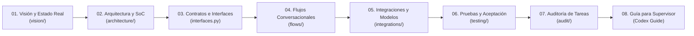

# LM-Chat™ — Bóveda de Documentación Técnica y Arquitectura

> **Capa de Inteligencia Espacial y Copiloto Autónomo para NVIDIA Omniverse**  
> **ID de Extensión Omniverse:** `orlandodorival.lm_chat`  
> **Versión de Software Activa:** `1.2.0` (SemVer 2.0.0) | **Commit de Referencia:** `c0c41db`  
> **Autor y Arquitecto Principal:** Orlando Dorival | **Entorno de Ejecución:** NVIDIA Omniverse Kit SDK 105 / 106 / 107+

Bienvenido a la documentación técnica oficial de **LM-Chat™**, diseñada y estructurada como una **bóveda documental reproducible Docs-as-Code** optimizada para su navegación fluida tanto en **Obsidian** como en **GitHub**.

Esta documentación reúne la arquitectura implementada, los contratos tipados, la auditoría integral de tareas, los flujos conversacionales asíncronos y los diagramas visuales editables de draw.io con previsualizaciones vectoriales SVG y rasterizadas PNG.

---

## 🗺️ 1. Mapa de Lectura y Navegación de la Bóveda

Para una revisión estructurada del sistema, siga el orden recomendado de lectura:

### 📚 Índice Detallado por Módulos

| Sección | Documento | Propósito y Contenido Clave |
| :--- | :--- | :--- |
| **01. Visión & Producto** | [01_PRODUCT_VISION_AND_REAL_STATE.md](vision/01_PRODUCT_VISION_AND_REAL_STATE.md) | Propuesta de valor, pilares técnicos, arquitectura objetivo vs. estado real implementado y fronteras de alcance. |
| **02. Arquitectura Macro** | [01_MACRO_ARCHITECTURE.md](architecture/01_MACRO_ARCHITECTURE.md) | Omniverse Kit como Microkernel, desacoplamiento estricto cognición-ejecución y respeto del bucle de 60 FPS RTX. |
| **02. Diseño de Sistema** | [02_SYSTEM_DESIGN.md](architecture/02_SYSTEM_DESIGN.md) | Separación de Preocupaciones (SoC), ISO/IEC 25010, capas Presentación (MDV), Infraestructura, Cognición y Dominio 3D. |
| **02. Decisiones (ADR)** | [03_ADR_LOG.md](architecture/03_ADR_LOG.md) | Registro de Decisiones Arquitectónicas (ADR-001 a ADR-007): layout Kit, AST sandbox, modos duales, streaming parser, persistencia. |
| **02. Contratos & Tipado** | [04_CONTRACTS_AND_INTERFACES.md](architecture/04_CONTRACTS_AND_INTERFACES.md) | Contratos formales de `core/interfaces.py` y `core/policies.py`: dataclasses, enums, métodos abstractos y typing. |
| **02. Persistencia & Ajustes**| [05_PERSISTENCE_AND_SETTINGS.md](architecture/05_PERSISTENCE_AND_SETTINGS.md) | Almacenamiento JSON seguro en `~/.omni_lm_chat/`, permisos `0o600`/`0o700`, gestión de VRAM en LM Studio y cluster multi-nodo. |
| **03. Flujos Conversacionales**| [01_CONVERSATIONAL_AND_EXECUTION_FLOWS.md](flows/01_CONVERSATIONAL_AND_EXECUTION_FLOWS.md) | Modos `IMMEDIATE` vs. `PLAN_AND_CONFIRM`, SSE streaming, tarjetas interactivas `PlanCard`, 3 intentos totales (1 inicial + 2 retries). |
| **04. Integraciones & LLMs** | [01_PROVIDERS_AND_MODEL_DISCOVERY.md](integrations/01_PROVIDERS_AND_MODEL_DISCOVERY.md) | Router multi-proveedor (LM Studio, Ollama, vLLM, Gemini, Claude, OpenAI), detección heurística vs. confirmada, MCP y plugins. |
| **05. Operación & Diagnóstico**| [01_INSTALLATION_AND_DIAGNOSTICS.md](operations/01_INSTALLATION_AND_DIAGNOSTICS.md) | Instalación en Omniverse Kit SDK 105-107, consola CLI REPL/headless, DiagnosticsEngine, tarjetas Markdown de error y logging. |
| **06. Pruebas & Calidad** | [01_TEST_PLAN_AND_ACCEPTANCE_MATRIX.md](testing/01_TEST_PLAN_AND_ACCEPTANCE_MATRIX.md) | Suite de 258 pruebas unitarias (100% pasando), arquitectura de mocks de Kit/USD vs. validaciones en Omniverse real. |
| **07. Auditoría de Tareas** | [01_TASK_AUDIT_AND_GAP_ANALYSIS.md](audit/01_TASK_AUDIT_AND_GAP_ANALYSIS.md) | Matriz exhaustiva de las 8 tareas del 14-Oct y eventos de Calendar/Tasks, análisis de brechas técnicas y criterios de cierre. |
| **08. Auditoría Codex** | [02_CODEX_SUPERVISOR_AUDIT_GUIDE.md](audit/02_CODEX_SUPERVISOR_AUDIT_GUIDE.md) | Guía de muestreo para el arquitecto auditor Codex: rutas de código, símbolos críticos, validación de invariantes y diagramas. |
| **09. Fuentes & Mant.** | [01_SOURCES_CATALOG_AND_MAINTENANCE.md](maintenance/01_SOURCES_CATALOG_AND_MAINTENANCE.md) | Catálogo de fuentes consultadas (Google Drive, Calendar, Tasks, archivos locales), limitaciones de acceso y protocolo de actualización. |
| **10. Estándares & Guías** | [01_CONTRIBUTING.md](standards/01_CONTRIBUTING.md) | Flujos de trabajo Git, SemVer 2.0.0 automatizado, Commitizen, branches protegidas y gobernanza de enjambres IA. |
| **10. Estándares & Guías** | [02_STYLE_GUIDE.md](standards/02_STYLE_GUIDE.md) | Guía de estilo de código: Google docstrings, tipado estricto, buenas prácticas OpenUSD y convenciones de diagramación. |
| **11. Adaptación .docx** | [01_SPECIFICATION_DOCX_ADAPTATION.md](history/01_SPECIFICATION_DOCX_ADAPTATION.md) | Transcripción estructurada del archivo original `LM_Chat_Product_Specification.docx`, análisis de procedencia y evolución histórica. |
| **12. Guía Obsidian** | [01_OBSIDIAN_VAULT_GUIDE.md](guides/01_OBSIDIAN_VAULT_GUIDE.md) | Instrucciones para abrir y revisar la carpeta `docs/` en Obsidian sin dependencias obligatorias ni errores de navegación. |

---

## 🎨 2. Galería de Diagramas de Arquitectura (Draw.io, SVG y PNG)

Todos los diagramas técnicos cuentan con triple representación:
1. **Archivo fuente `.drawio` editable:** Ubicado en [`diagrams/src/`](diagrams/src/), completamente compatible con el editor draw.io y con el plugin de Obsidian.
2. **Previsualización vectorial `.svg`:** Renderizada con alta fidelidad para navegación web y Obsidian.
3. **Previsualización rasterizada `.png`:** Con fondo transparente para entornos de alta compatibilidad.

| ID | Diagrama | Enlaces de Visualización y Edición |
| :---: | :--- | :--- |
| **D1** | **Contexto del Sistema y Límites de Confianza** | [Ver SVG](diagrams/svg/01_system_context.svg) • [Ver PNG](diagrams/png/01_system_context.png) • [Editar .drawio](diagrams/src/01_system_context.drawio) |
| **D2** | **Arquitectura de Componentes e Interfaces** | [Ver SVG](diagrams/svg/02_component_architecture.svg) • [Ver PNG](diagrams/png/02_component_architecture.png) • [Editar .drawio](diagrams/src/02_component_architecture.drawio) |
| **D3** | **Flujo Conversacional GUI/CLI y Modos de Ejecución** | [Ver SVG](diagrams/svg/03_conversational_flow.svg) • [Ver PNG](diagrams/png/03_conversational_flow.png) • [Editar .drawio](diagrams/src/03_conversational_flow.drawio) |
| **D4** | **Ciclo de Inferencia, Streaming SSE y Herramientas MCP** | [Ver SVG](diagrams/svg/04_inference_streaming_tools.svg) • [Ver PNG](diagrams/png/04_inference_streaming_tools.png) • [Editar .drawio](diagrams/src/04_inference_streaming_tools.drawio) |
| **D5** | **Pipeline OpenUSD, Gobernanza AST y ReAct Loop** | [Ver SVG](diagrams/svg/05_usd_execution_and_error_recovery.svg) • [Ver PNG](diagrams/png/05_usd_execution_and_error_recovery.png) • [Editar .drawio](diagrams/src/05_usd_execution_and_error_recovery.drawio) |
| **D6** | **Ciclo de Vida de Sesiones, Persistencia y Configuración** | [Ver SVG](diagrams/svg/06_persistence_session_lifecycle.svg) • [Ver PNG](diagrams/png/06_persistence_session_lifecycle.png) • [Editar .drawio](diagrams/src/06_persistence_session_lifecycle.drawio) |

### Vista Previa Arquitectónica Central

---

## 🏛️ 3. Invariantes Arquitectónicas Fundamentales (AGENTS.md)

Cualquier cambio, módulo o extensión debe satisfacer rigurosamente los 4 principios de invariancia del proyecto:

1. **Mutaciones USD No Destructivas (Command Pattern):**
   Queda estrictamente prohibido mutar la escena OpenUSD mediante escrituras crudas que eludan el historial de Omniverse. Toda modificación de prims, luces o materiales debe ejecutarse mediante `omni.kit.commands.execute()` o bloques `omni.kit.undo`, garantizando soporte nativo para `Ctrl+Z` / `Ctrl+Y`.
2. **Bucle Sagrado de Renderizado a 60 FPS Asíncronos:**
   La inferencia LLM, el streaming SSE, las peticiones HTTP y las llamadas a herramientas MCP nunca deben bloquear el hilo principal de renderizado de Omniverse Kit.
3. **Bucle ReAct de Autorreflexión y Autocorrección:**
   Ante excepciones de sintaxis o fallos de tipado USD (`Sdf.PathError`, `Tf.DiagnosticMark`), el sistema intercepta el traceback y solicita autocorrección al modelo hasta agotar el límite configurado (3 intentos totales: 1 inicial + 2 reintentos).
4. **Descomposición Modular Contrato-Primero:**
   Toda funcionalidad mayor define contratos tipados en `core/interfaces.py` y políticas de seguridad en `core/policies.py` antes de escribir la lógica concreta.

---

## 💻 4. Configuración y Uso de la Bóveda en Obsidian

Para abrir esta documentación en **Obsidian**:
1. Abra Obsidian y seleccione **"Open folder as vault"** (Abrir carpeta como bóveda).
2. Seleccione la ruta física: `C:\Users\Orlando\Desktop\LM-Chat\docs`.
3. La configuración básica contenida en `.obsidian/app.json` activará la lectura sin requerir plugins comunitarios obligatorios.
4. Para editar diagramas `.drawio` directamente dentro de Obsidian, se puede instalar opcionalmente el plugin comunitario *Draw.io Obsidian Integration*, o bien abrir los archivos `.drawio` con la aplicación externa [diagrams.net](https://app.diagrams.net/).
5. Para más detalles, consulte la [Guía de la Bóveda Obsidian](guides/01_OBSIDIAN_VAULT_GUIDE.md).
