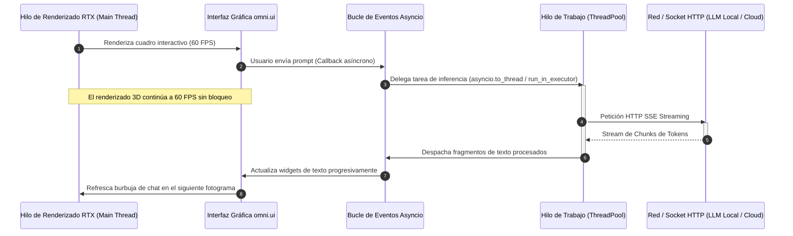
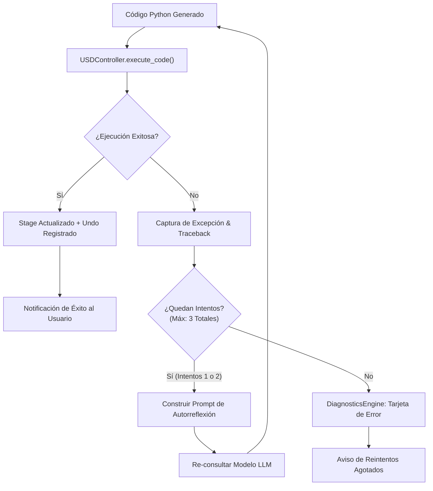

# Macro-Arquitectura: Motor 3D y Agente Cognitivo

## 1. Fundamentos Arquitectónicos

Este documento expone la macro-arquitectura de integración entre el motor de simulación y renderizado 3D **NVIDIA Omniverse** y la capa de inteligencia artificial espacial **LM-Chat™**. Su objetivo es definir las fronteras de aislamiento, el modelo de concurrencia e hilos, y las garantías de estabilidad que gobiernan el sistema.


*Figura 1: Contexto general del sistema, límites de confianza y dependencias externas. [Editar archivo fuente (.drawio)](../diagrams/src/01_system_context.drawio) • [Ver PNG](../diagrams/png/01_system_context.png).*

---

## 2. Omniverse Kit como Microkernel

El sistema adopta el patrón arquitectónico de **Microkernel**, donde **NVIDIA Omniverse Kit** actúa como el núcleo computacional central:
- Provee los servicios críticos de más bajo nivel: el bucle principal de renderizado en tiempo real (RTX / Pathtracing), la pila de simulación física (PhysX 5), el gestor de eventos del ciclo de vida y la infraestructura de manipulación de grafos de escena OpenUSD.
- Nuestra extensión `orlandodorival.lm_chat` opera como un módulo periférico desacoplado.

Al tratar a Omniverse Kit como un Microkernel, se impone una regla no negociable: **el agente cognitivo no intercepta ni interfiere de forma síncrona con el bucle de renderizado**. La comunicación ocurre mediante interfaces asíncronas y eventos despachados en corrutinas de Python gestionadas en hilos secundarios.

---

## 3. Modelo de Hilos y el Bucle Sagrado de 60 FPS

En aplicaciones interactivas 3D y gemelos digitales, la fluidez visual a **60 FPS constantes (16.6 ms por cuadro)** es un requisito de diseño crítico. Cualquier congelamiento de la interfaz debido a operaciones de red o inferencia lingüística destruye la experiencia de inmersión y puede provocar desconexiones del pipeline RTX.



### Reglas de Implementación de Concurrencia
1. **Prohibición de I/O Síncrono en el Main Thread:** Está estrictamente vetado el uso de llamadas bloqueantes como `requests.get()`, `urllib.request.urlopen()` síncronos o `time.sleep()` dentro de los callbacks de `omni.ui`.
2. **Uso de Clientes Asíncronos:** Toda comunicación de red se realiza mediante `aiohttp.ClientSession` asíncrono o wrappers de streaming adaptados a corrutinas con timeouts explícitos de hasta 600 segundos.
3. **Puntualización de Mutaciones USD:** La aplicación final del código generado en el Stage OpenUSD debe ejecutarse en el contexto seguro del hilo principal mediante `omni.kit.commands.execute()`, asegurando que la estructura del grafo de escena permanezca consistente durante el rasterizado de la GPU.

---

## 4. Desacoplamiento Estricto: Cognición vs. Ejecución

Para garantizar la estabilidad a largo plazo del ecosistema, se impone una estricta separación de responsabilidades:

### A. Capa Cognitiva (`logic/agent_manager.py`)
- Responsable de la gestión de la memoria de corto plazo, historial conversacional, deducción de intenciones y orquestación de herramientas.
- Es agnóstica de los punteros internos de memoria del motor gráfico. No interactúa directamente con objetos C++ de USD (`pxr.Usd.Prim`).
- Opera en base a representaciones abstractas serializadas (JSON) proporcionadas por el serializador de contexto.

### B. Capa de Ejecución y Dominio 3D (`logic/usd_controller.py`, `logic/usd_inspector.py`)
- Responsable de traducir las decisiones abstractas en transformaciones geométricas deterministas y auditables.
- Aplica el **Patrón Comando** para garantizar soporte de Deshacer/Rehacer (`Ctrl+Z` / `Ctrl+Y`).
- No gestiona el lenguaje natural. Reporta resultados mediante diccionarios fuertemente estructurados:
  ```python
  {"success": bool, "error_msg": Optional[str], "data": Optional[Dict[str, Any]]}
  ```

---

## 5. Resiliencia Agéntica: Bucle ReAct y Reflexión de Tracebacks

Cuando un bloque de código Python generado por el modelo lingüístico falla durante su ejecución en el escenario OpenUSD (por ejemplo, debido a una ruta de prim inexistente `Sdf.PathError`, un tipo incompatible o una restricción de la política de seguridad AST), el sistema no aborta la sesión ni presenta un fallo catastrófico al usuario:



> [!IMPORTANT]
> **Aclaración de Métrica de Reintentos:** En la implementación física de `AgentManager.process_prompt()`, la variable `max_retries = 2` junto con el bucle `range(max_retries + 1)` establece **3 intentos totales**:
> - **Intento 0:** Intento de ejecución inicial.
> - **Intento 1:** Primer reintento de autocorrección reflexiva.
> - **Intento 2:** Segundo reintento de autocorrección reflexiva.  
> Si el fallo persiste tras el tercer intento, el bucle se detiene de forma determinista para prevenir bucles infinitos de consumo de tokens.
