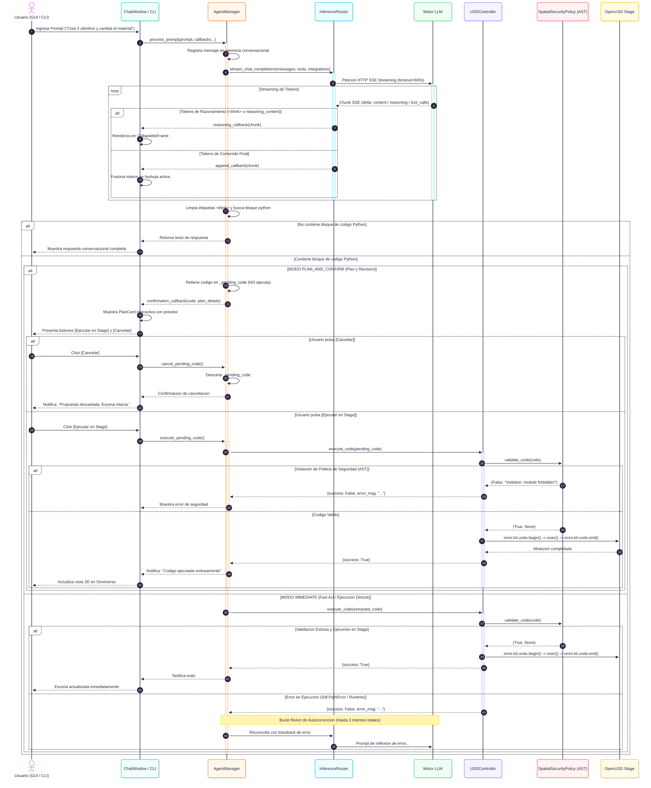

# Diseño del Sistema y Separación de Preocupaciones (SoC)

## 1. Fundamentos ISO/IEC 25010 y SoC

La arquitectura de **LM-Chat™** abraza el principio de **Separación de Preocupaciones (Separation of Concerns - SoC)** como base primordial para asegurar las características de calidad exigidas por el estándar internacional **ISO/IEC 25010**:

1. **Mantenibilidad (Modularidad y Desacoplamiento):** La fragmentación del código en capas desacopladas garantiza que sustituir o actualizar un componente (como añadir un nuevo proveedor de inferencia, actualizar el protocolo MCP o modificar los componentes visuales de `omni.ui`) tenga un impacto nulo o estrictamente acotado en el resto de los módulos.
2. **Fiabilidad (Tolerancia a Fallos y Resiliencia):** El encapsulamiento preventivo restringe la onda expansiva de las excepciones. Un corte de conexión con el proveedor LLM o un error de sintaxis en el código OpenUSD no provoca la caída del proceso principal de NVIDIA Omniverse.
3. **Seguridad (Gobernanza Espacial y Mínimo Privilegio):** El aislamiento de ejecución mediante análisis estático AST (`SpatialSecurityPolicy`) y un diccionario de `__builtins__` restringido impide que código generado malicioso o erróneo comprometa el sistema operativo host.
4. **Eficiencia de Rendimiento (Sacred 60 FPS):** La gestión asíncrona mediante corrutinas de `asyncio` y pools de trabajo garantiza que el hilo de renderizado RTX no experimente degradación de fotogramas.


*Figura 2: Diagrama de componentes, contratos de interfaces e inyección de dependencias. [Editar archivo fuente (.drawio)](../diagrams/src/02_component_architecture.drawio) • [Ver PNG](../diagrams/png/02_component_architecture.png).*

---

## 2. Desglose Estructural de Capas

El árbol de directorios de la extensión bajo `exts/orlandodorival.lm_chat/` se organiza en las siguientes capas de responsabilidad bien definidas:

```
exts/orlandodorival.lm_chat/
├── config/
│   └── extension.toml              # Metadatos del paquete y configuración Kit
├── core/
│   ├── interfaces.py               # Contratos formales, tipado y dataclasses
│   └── policies.py                 # Gobernanza espacial y validación AST
├── ui/
│   ├── chat_window.py              # Ventana principal omni.ui (Model-Delegate-View)
│   ├── models.py                   # Modelos de datos y estados de la UI
│   └── settings_window.py          # Ventana modal de ajustes y diagnóstico
├── logic/
│   ├── agent_manager.py            # Orquestación conversacional y bucle ReAct
│   ├── inference_router.py         # Enrutamiento streaming multi-proveedor
│   ├── usd_controller.py           # Adaptador de mutación OpenUSD y Undo
│   ├── usd_inspector.py            # Auditoría de assets y layer stack
│   ├── usd_context.py              # Serializador espacial de contexto JSON
│   ├── chat_history.py             # Persistencia local atómica de sesiones
│   ├── settings_manager.py         # Gestión de configuración (~/.omni_lm_chat/)
│   ├── cluster_manager.py          # Balanceo de carga y conmutación por error
│   ├── lm_studio_vram.py           # Descarga de VRAM en LM Studio 0.4.x+
│   ├── diagnostics.py              # Motor de diagnósticos inteligentes
│   └── logger.py                   # Buffer circular estructurado y logs carb
└── mcp/
    └── omni_mcp_registry.py        # Conexión stdio a servidores MCP (JSON-RPC 2.0)
```

### Capa 1: Presentación Visual (`ui/`)
- **Arquitectura Model-Delegate-View (MDV):** En lugar de MVC tradicional, la interfaz se desacopla mediante el patrón nativo de `omni.ui`:
  - **Model (`ChatModel` en `ui/models.py`):** Mantiene la lista de mensajes, estado de carga y badges.
  - **Delegate (`ChatDelegate` en `ui/chat_window.py`):** Vincula las acciones de usuario con callbacks delegados al orquestador superior mediante inyección de dependencias.
  - **View (`ChatWindow`):** Construye y gestiona los componentes gráficos (`ScrollingFrame`, `CollapsibleFrame` para razonamiento, tarjetas `PlanCard` y badges dinámicos).
- **Fusión de Burbujas Progresivas:** El método `append_to_last_message()` actualiza el texto de la burbuja activa en tiempo real según llegan los chunks SSE, evitando la proliferación de widgets huérfanos.

### Capa 2: Contratos e Interfaces (`core/`)
- Define las interfaces abstractas puras (`ABC`) en `core/interfaces.py`: `IInferenceRouter`, `IUSDController`, `IUSDInspector`, `IAgentPolicy`, `IMCPClientRegistry`, `IChatHistoryManager`, `ISettingsManager`, `IClusterManager`, `ILMStudioVRAMManager`.
- Establece la regla de desarrollo *Contract-First*: ningún agente autónomo o desarrollador humano implementa lógica concreta sin que el contrato tipado y sus pruebas estén previamente consolidados.

### Capa 3: Negocio, Cognición y Enrutamiento (`logic/`)
- **`AgentManager`:** Coordina el ciclo de vida del turno conversacional, la preparación de herramientas MCP, la detección de modos (`IMMEDIATE` vs `PLAN_AND_CONFIRM`) y el bucle ReAct de autocorrección de código.
- **`InferenceRouter`:** Gateway unificado de inferencia que normaliza las discrepancias de protocolo entre la API de OpenAI, la API de Anthropic (con alternancia estricta de roles y parámetro `system`), APIs locales (Ollama, LM Studio) y modelos de razonamiento (extracción de `<think>` y adaptación de `temperature`).
- **`ClusterManager`:** Provee conmutación por error (failover) y balanceo inteligente entre múltiples nodos de inferencia locales o remotos, calculando latencias dinámicas mediante health checks asíncronos.
- **`LMStudioVRAMManager`:** Facilita la descarga selectiva de modelos cargados en GPU a través de `POST /api/v1/models/unload`, permitiendo liberar VRAM para el pipeline de trazado de rayos (RTX) de Omniverse.

### Capa 4: Dominio 3D y Gobernanza Espacial (`logic/usd_*.py`, `core/policies.py`)
- **`USDController`:** El ejecutor exclusivo de operaciones en la escena. Todo bloque de código generado pasa por `SpatialSecurityPolicy` antes de alcanzar el Stage.
- **`SpatialSecurityPolicy`:** Analizador estático basado en el módulo estándar `ast` de Python. Audita el árbol sintáctico en busca de módulos prohibidos (`subprocess`, `socket`, `shutil`), llamadas peligrosas a `os.*`, bucles infinitos estáticos (`while True:` sin `break`) y modificaciones a prims reservados del sistema (`/OmniverseKit_Root`, `/Render`).
- **`USDInspector`:** Provee al agente de capacidades de diagnóstico de la escena: escaneo de texturas y referencias rotas (`audit_missing_assets`), búsqueda de prims por propiedades semánticas (`find_prims_by_query`) y estado de la pila de capas (`get_layer_stack_status`).

### Capa 5: Integración Externa y Herramientas (`mcp/`)
- **`OmniMCPRegistry` y `MCPServerConnection`:** Implementan el transporte estándar sobre entrada y salida estándar (`stdio`) del Model Context Protocol utilizando serialización JSON-RPC 2.0. Permite registrar servidores de documentación, CAD o sistemas de archivos locales, exponiendo sus capacidades al modelo como funciones invocables.

### Capa 6: Persistencia y Diagnóstico (`logic/chat_history.py`, `logic/diagnostics.py`)
- **`LocalChatHistoryManager`:** Garantiza la persistencia atómica en disco bajo `~/.omni_lm_chat/sessions/`. Utiliza permisos seguros (`0o600` para archivos y `0o700` para carpetas) y escribe primero en un archivo `.tmp` antes de ejecutar `os.replace`, previniendo corrupciones de datos ante cierres inesperados.
- **`DiagnosticsEngine`:** Captura excepciones de red, timeouts o rechazos de conexión y las traduce a tarjetas enriquecidas en Markdown con causas probables y botones de acción rápida.

---

## 3. Diagrama de Flujo Asíncrono e Interacción entre Capas

El siguiente diagrama detalla la interacción y el flujo de control entre todas las capas durante una solicitud interactiva del usuario:


*Figura 3: Flujo conversacional GUI/CLI y bifurcación entre modo inmediato y modo plan. [Editar archivo fuente (.drawio)](../diagrams/src/03_conversational_flow.drawio) • [Ver PNG](../diagrams/png/03_conversational_flow.png).*
