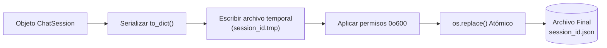

# Historial, Persistencia y Gestión de Configuración

## 1. Topología del Almacenamiento Local (`~/.omni_lm_chat/`)

**LM-Chat™** adopta una política de almacenamiento 100% local, soberana y privada. No se envían historiales ni configuraciones de usuario a servidores remotos ni telemetría no solicitada.

Toda la persistencia se centraliza en el directorio de usuario del sistema operativo:
```
~/.omni_lm_chat/
├── settings.json                   # Configuración global, proveedores y clusters
├── sessions/                       # Sesiones persistentes de chat (JSON)
│   ├── a1b2c3d4e5f6...json
│   └── 9876543210ab...json
└── logs/                           # Archivos rotativos de diagnóstico
    └── lmchat.log
```


*Figura 6: Ciclo de vida de sesiones, persistencia atómica y flujo de configuración. [Editar archivo fuente (.drawio)](../diagrams/src/06_persistence_session_lifecycle.drawio) • [Ver PNG](../diagrams/png/06_persistence_session_lifecycle.png).*

---

## 2. Persistencia Atómica y Resiliencia ante Fallos

La persistencia de sesiones conversacionales se implementa en `LocalChatHistoryManager` (`logic/chat_history.py`) cumpliendo con estrictas garantías ACID a nivel de sistema de archivos:



1. **Escritura en Dos Fases (Two-Phase Atomic Commit):**
   Para evitar que un cierre forzado de NVIDIA Omniverse o un corte de energía deje un archivo JSON corrupto a medio escribir, el gestor escribe primero en un archivo temporal (`<session_id>.tmp`), ejecuta `flush()` y `os.fsync()`, y finalmente realiza un reemplazo atómico mediante `os.replace()`.
2. **Permisos Restrictivos de Seguridad:**
   Tanto en entornos Linux como en Windows (vía flags de compatibilidad POSIX), los directorios se crean con máscara `0o700` (lectura/escritura/ejecución exclusiva del usuario propietario) y los archivos de sesión con `0o600` (lectura y escritura restringida), previniendo accesos indebidos en sistemas multi-usuario.
3. **Protección Contra Recorrido de Directorios (Path Traversal):**
   Todo identificador de sesión recibido en peticiones de guardado, carga o importación es sometido a un filtro de sanitización estricto mediante regex (`re.sub(r'[^a-zA-Z0-9_-]', '', session_id)`), impidiendo que secuencias maliciosas como `../../` escapen del directorio de almacenamiento.
4. **Búsqueda Monopasada en Disco:**
   El método `search_sessions(query)` realiza un escaneo de alto rendimiento en una sola pasada de lectura, evaluando coincidencias insensibles a mayúsculas/minúsculas en el título, las etiquetas de metadatos y el cuerpo completo de los mensajes.

---

## 3. Formato y Estructura de Sesión JSON

Cada archivo `<session_id>.json` cumple con el siguiente esquema serializado:

```json
{
  "session_id": "4a7f9b2c8e1d403fa8d9e2b1049c8f3e",
  "title": "Modelado de Celda Robótica Industrial",
  "created_at": "2026-10-14T19:30:00.000000+00:00",
  "updated_at": "2026-10-14T19:35:12.450120+00:00",
  "messages": [
    {
      "role": "user",
      "content": "Crea una cinta transportadora con 4 cubos rígidos",
      "metadata": {}
    },
    {
      "role": "assistant",
      "content": "Entendido. A continuación presento el código OpenUSD...",
      "metadata": {
        "execution_mode": "plan_and_confirm",
        "model": "gemini-3.8-flash"
      }
    }
  ],
  "metadata": {
    "provider": "google_gemini",
    "stage_target": "/World/RoboticsCell"
  }
}
```

---

## 4. Gestión de Configuración Global (`SettingsManager`)

El archivo `settings.json` almacena las preferencias operativas del usuario, credenciales resueltas y servidores configurados:

```json
{
  "default_provider": "LM Studio",
  "default_models": {
    "LM Studio": "google/gemma-4-e4b",
    "Ollama": "deepseek-r1:8b",
    "Google Gemini": "gemini-3.8-flash",
    "OpenAI": "gpt-4o",
    "Anthropic": "claude-3-7-sonnet"
  },
  "providers": {
    "LM Studio": {
      "base_url": "http://localhost:1234/v1",
      "api_key": null,
      "timeout": 600.0,
      "temperature": 0.2
    },
    "Google Gemini": {
      "base_url": "https://generativelanguage.googleapis.com/v1beta/openai",
      "api_key": null,
      "timeout": 600.0,
      "temperature": 0.7
    }
  },
  "execution_mode": "immediate",
  "turbo_mode": false,
  "mcp_servers": [
    {
      "name": "cad_specs",
      "command": "python",
      "args": ["-m", "mcp_cad_server"],
      "enabled": true
    }
  ],
  "cluster_config": {
    "strategy": "priority",
    "nodes": [
      {
        "name": "Local RTX 5060",
        "url": "http://localhost:1234/v1",
        "weight": 1,
        "is_active": true
      },
      {
        "name": "Secondary Workstation",
        "url": "http://192.168.1.150:1234/v1",
        "weight": 2,
        "is_active": true
      }
    ]
  }
}
```

### Resolución de API Keys
`SettingsManager.get_effective_api_key()` implementa una cascada de resolución:
1. Clave explícitamente guardada por el usuario en `settings.json`.
2. Si es nula o vacía, consulta las variables de entorno del sistema (`GEMINI_API_KEY`, `GOOGLE_API_KEY`, `OPENAI_API_KEY`, `ANTHROPIC_API_KEY`).
3. Si ninguna existe, se devuelven cadenas vacías permitiendo que el motor de diagnóstico alerte al usuario con una tarjeta visual en la interfaz.

---

## 5. Orquestación Multi-Nodo y Gestión de VRAM

### `ClusterManager` (`logic/cluster_manager.py`)
Permite orquestar clusters de inferencia distribuidos mediante tres estrategias de selección:
- **`priority`:** Enruta siempre al nodo activo de mayor prioridad; si falla, conmuta automáticamente al siguiente nodo saludable.
- **`round_robin`:** Distribuye las solicitudes equitativamente entre todos los nodos saludables.
- **`lowest_latency`:** Ejecuta sondas concurrentes de latencia HTTP y redirige las peticiones al nodo con menor tiempo de respuesta.

### `LMStudioVRAMManager` (`logic/lm_studio_vram.py`)
En estaciones con recursos GPU limitados, el botón "Liberar VRAM" de la interfaz gráfica invoca:
```http
POST /api/v1/models/unload HTTP/1.1
Host: localhost:1234
Content-Type: application/json

{
  "instance_id": "<loaded_model_id>"
}
```
Esto descarga el modelo de la memoria gráfica, garantizando que el pipeline de renderizado RTX de Omniverse disponga de la totalidad de la VRAM para texturas de alta resolución y simulaciones PhysX.
