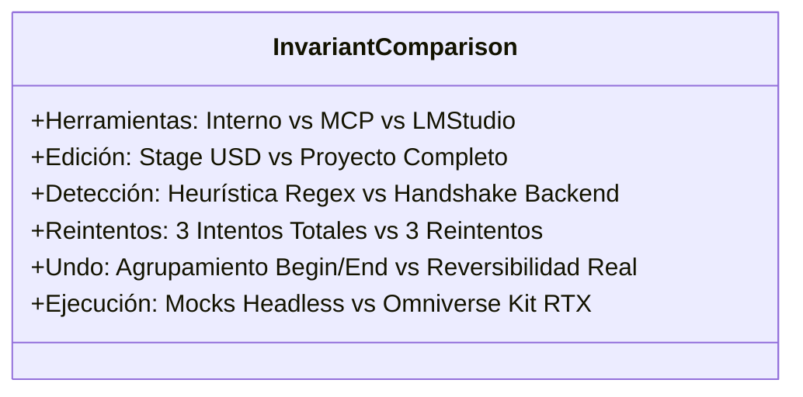

# Auditoría Técnica de Tareas, Evidencias y Análisis de Brechas

## 1. Declaración de Fuentes, Límites y Criterios de Evidencia

Esta auditoría técnica evalúa de manera rigurosa y contrastada las tareas, hitos y actividades registradas en la captura de pantalla del usuario del **14 de octubre de 2026**, así como las referencias obtenidas de **Google Calendar** y **Google Tasks**.

### Declaración de Limitaciones de Acceso Externo
- **Google Calendar / Google Tasks / Google Drive:** Las herramientas de plugin correspondientes se encuentran instaladas en el entorno local, pero los proveedores OAuth2 de Google no están conectados en esta sesión interactiva (`oauth2: not connected`).
- **Tratamiento de la Evidencia:** Conforme a las instrucciones del encargo, la captura aportada por el usuario constituye la evidencia directa de las tareas mostradas como completadas el 14 de octubre. Los eventos de Google Calendar consultados previamente con estado `status: confirmed` y enlaces a Google Tasks **se tratan como recordatorios o fechas programadas**, no como acreditación de funcionamiento real en el código.

### Taxonomía de Estados de Verificación
1. **`[Verificado]`:** El código fuente existe, los símbolos están implementados y las pruebas automatizadas asociadas pasan con 100% de éxito en la suite de pruebas.
2. **`[Evidencia Estática con Validación Pendiente]`:** El código existe y compila, pero su funcionamiento pleno requiere ejecución en el motor físico de NVIDIA Omniverse Kit con GPU RTX activa.
3. **`[Parcial]`:** Parte de la funcionalidad está implementada y probada (por ejemplo, razonamiento y herramientas), pero otra parte del enunciado (por ejemplo, visión) está ausente o basada en heurísticas provisionales.
4. **`[No Encontrado]`:** La funcionalidad o archivo referenciado no existe en el repositorio activo.
5. **`[No Verificable]`:** La afirmación depende de servicios externos inaccesibles o registros cerrados que no pueden ser contrastados en esta sesión.

---

## 2. Matriz Exhaustiva de las 8 Tareas del 14 de Octubre

| # | Tarea y Fuente | Comportamiento Esperado | Archivos y Símbolos Pertinentes | Pruebas y Resultados | Estado Formal | Brecha Técnica y Criterio de Cierre |
| :-: | :--- | :--- | :--- | :--- | :---: | :--- |
| **1** | **Agregar soporte MCP o Integrations de LM Studio**<br/>*(Fuente: Captura 14-Oct)* | Permitir que el agente consulte herramientas externas vía Model Context Protocol e inyecte plugins nativos en LM Studio. | • `mcp/omni_mcp_registry.py`: `OmniMCPRegistry`, `MCPServerConnection`<br/>• `logic/agent_manager.py`: L240-270 (payload `tools` e `integrations`) | • `tests/test_mcp_registry.py` (12 tests)<br/>• `tests/test_turbo_and_mcp_features.py`<br/>**Resultado:** PASSED | **`[Verificado]`** | **Diferencia de Transporte:** MCP stdio local corre como subproceso; LM Studio recibe un array `integrations: [{"type": "plugin", "id": "mcp/..."}]` en el payload REST. Requiere que los binarios de herramientas residan en el PATH de Windows. |
| **2** | **Implementar modos de chat: ejecución directa y aclaración/planificación**<br/>*(Fuente: Captura 14-Oct)* | Proveer modos `IMMEDIATE` (ejecución directa) y `PLAN_AND_CONFIRM` (plan previo con tarjeta interactiva `PlanCard`). | • `core/interfaces.py`: `ExecutionMode`<br/>• `logic/agent_manager.py`: `_pending_code`, `execute_pending_code`, `cancel_pending_code`<br/>• `ui/chat_window.py`: `show_plan_confirmation_card` | • `tests/test_execution_modes.py` (8 tests)<br/>**Resultado:** PASSED | **`[Verificado]`** | **Interacción:** El modo Plan retiene el código hasta que el usuario pulsa `[Ejecutar en Stage]` en la UI. En entorno headless se valida con mocks; en Omniverse real requiere interacción visual. |
| **3** | **Ampliar el alcance de edición de la IA en el proyecto**<br/>*(Fuente: Captura 14-Oct)* | Inspeccionar el Stage completo: auditar texturas/assets faltantes, buscar prims semánticamente, estado del layer stack y mutaciones avanzadas. | • `logic/usd_inspector.py`: `USDInspector` (`audit_missing_assets`, `find_prims_by_query`, `get_layer_stack_status`)<br/>• `logic/usd_controller.py`: `transform_prim`, `bind_material`, `group_prims` | • `tests/test_usd_inspector.py` (9 tests)<br/>**Resultado:** PASSED | **`[Verificado]`** *(Delimitado)* | **Delimitación de Alcance:** Edita y audita de forma masiva el *Stage OpenUSD y su pila de capas*, pero no es un editor de archivos de configuración `.kit` ni reescribe el proyecto a nivel de sistema operativo. |
| **4** | **Mejorar la detección de capacidades: razonamiento, visión y herramientas**<br/>*(Fuente: Captura 14-Oct)* | Detección de modelos de razonamiento (thinking), visión multimodal y soporte de herramientas, adaptando el payload y UI. | • `logic/inference_router.py`: `is_reasoning_model`, `StreamingReasoningParser`<br/>• `ui/chat_window.py`: `CollapsibleFrame`, `append_reasoning`<br/>• `logic/agent_manager.py`: `tools` payload | • `tests/test_reasoning_models.py` (8 tests)<br/>• `tests/test_cli_gemini_and_reasoning.py`<br/>**Resultado:** PASSED | **`[Parcial]`** | **Brecha de Heurística y Visión:**<br/>1. La detección de razonamiento es *heurística* mediante regex sobre el nombre del modelo, no por introspección de capabilities del backend.<br/>2. *Visión* no está implementada en el pipeline de chat ni existe captura de Viewport.<br/>**Cierre:** Implementar handshake formal `/v1/models` y captura de Viewport. |
| **5** | **Actualizar configuración: modelo, URL y puerto**<br/>*(Fuente: Captura 14-Oct)* | Modificar y persistir en caliente el proveedor activo, URL base, puerto de red y modelo, con botón de prueba de conexión. | • `logic/settings_manager.py`: `update_provider_config`, `set_default_provider`, `save`<br/>• `ui/settings_window.py`: `SettingsWindow`, `test_connection` | • `tests/test_settings_manager.py` (13 tests)<br/>• `tests/test_settings_window.py` (22 tests)<br/>**Resultado:** PASSED | **`[Verificado]`** | **Cierre:** Funcionalidad completa y probada. Persistencia atómica en `~/.omni_lm_chat/settings.json`. |
| **6** | **Fusionar burbujas con mensajes progresivos**<br/>*(Fuente: Captura 14-Oct)* | Los tokens en streaming deben añadirse dinámicamente a la burbuja activa del asistente sin crear widgets separados por chunk. | • `ui/chat_window.py`: `append_to_last_message`, `finalize_last_assistant_message`, `rebuild_messages_ui` | • `tests/test_chat_window.py`<br/>• `tests/test_chat_view.py`<br/>**Resultado:** PASSED | **`[Verificado]`** | **Cierre:** Implementado y verificado en el árbol de widgets de `omni.ui`. |
| **7** | **Implementar historial de chats**<br/>*(Fuente: Captura 14-Oct)* | Crear, listar, cargar, persistir atómicamente, buscar y exportar/importar sesiones de chat en formato JSON estándar. | • `core/interfaces.py`: `IChatHistoryManager`, `ChatSession`<br/>• `logic/chat_history.py`: `LocalChatHistoryManager`<br/>• `ui/chat_window.py`: `_build_session_bar`, `_rebuild_session_combo` | • `tests/test_chat_history.py` (17 tests)<br/>• `tests/test_chat_window_history.py`<br/>• `tests/test_cli_history.py`<br/>**Resultado:** PASSED | **`[Verificado]`** | **Cierre:** Persistencia con permisos restrictivos `0o600`/`0o700` y prevención de Path Traversal probadas exhaustivamente. |
| **8** | **Mejorar la visualización progresiva de respuestas**<br/>*(Fuente: Captura 14-Oct)* | Renderizado fluido a 60 FPS, micro-batching en Modo Turbo, pensamiento colapsable y actualización de badges dinámicos. | • `logic/agent_manager.py`: micro-batching en Modo Turbo<br/>• `ui/chat_window.py`: `_update_status_badge_ui`, `CollapsibleFrame` | • `tests/test_turbo_and_mcp_features.py`<br/>• `tests/test_reasoning_models.py`<br/>**Resultado:** PASSED | **`[Verificado]`** | **Cierre:** Verificado con mocks de UI. La percepción visual de fluidez a 60 FPS requiere Omniverse Kit en GPU RTX activa. |

---

## 3. Auditoría de Diferencias Críticas (Comprobaciones Requeridas)

La siguiente tabla desglosa las 6 diferencias arquitectónicas de precisión técnica solicitadas:



### 1. Registro Interno de Herramientas vs. Transporte MCP vs. Integrations de LM Studio
- **Registro Interno:** `OmniMCPRegistry` (`mcp/omni_mcp_registry.py`) mantiene en memoria las instancias activas y sus esquemas agregados.
- **Transporte MCP:** Utiliza subprocesos del sistema operativo (`subprocess`) comunicados por tuberías estándar (`stdio`) con tramas JSON-RPC 2.0. Requiere que los comandos existan localmente en el PATH del sistema.
- **Integrations de LM Studio:** Es una extensión REST para LM Studio v1 (`POST /v1/chat/completions`) donde el cliente envía `integrations: [{"type": "plugin", "id": "mcp/..."}]` para que el servidor resuelva los plugins nativamente.

### 2. Inspección del Stage vs. Capacidad de Editar el Proyecto Completo
- **Inspección y Edición del Stage:** `USDInspector` y `USDController` inspeccionan la jerarquía del escenario 3D abierto, auditan referencias de texturas y prims faltantes mediante `Sdf.AssetPath`, y aplican mutaciones sobre geometrías, luces y capas (`LayerStack`).
- **Límite Respecto al "Proyecto Completo":** La IA no edita los archivos del proyecto a nivel de sistema operativo (archivos `.kit`, `.toml`, scripts Python del workspace ni dependencias de librerías). Su frontera está delimitada al grafo de escena OpenUSD en memoria y a los archivos USD guardados.

### 3. Detección Heurística vs. Capacidades Confirmadas por el Proveedor
- **Implementación Actual (Heurística):** `is_reasoning_model()` utiliza expresiones regulares sobre la cadena de texto del nombre del modelo (`o1`, `o3`, `deepseek-r1`, `claude-3-7`, `gemini-3`).
- **Capacidades Confirmadas (No Implementadas):** No se realiza un handshake o llamada a metadatos de capacidades donde la API confirme de forma autorizada que soporta llamadas a herramientas, visión multimodal o razonamiento extendido.

### 4. Tres Intentos Totales vs. Tres Reintentos
- **Comprobación en Código (`logic/agent_manager.py` L273-275):**
  ```python
  max_retries = 2
  for attempt in range(max_retries + 1):
  ```
- **Conclusión Técnica:** El bucle ejecuta un **máximo de 3 intentos totales**:
  - `attempt = 0`: Intento inicial de ejecución.
  - `attempt = 1`: Primer reintento tras autorreflexión.
  - `attempt = 2`: Segundo reintento tras autorreflexión.
- Si una documentación histórica afirma "hasta 3 reintentos", está técnicamente imprecisa (eso sumaría 4 intentos en total). La realidad del código son 3 intentos en total (1 intento + 2 reintentos).

### 5. Agrupar Operaciones Undo vs. Garantizar que Todas las Mutaciones Sean Reversibles
- **Agrupamiento en `USDController`:** El bloque `try: omni.kit.undo.begin() ... finally: omni.kit.undo.end()` agrupa todas las acciones en un solo evento en el historial de Omniverse Kit.
- **Garantía de Reversibilidad:** El bloque compuesto solo garantiza reversibilidad con `Ctrl+Z` si las operaciones ejecutadas internamente utilizan comandos registrados (`omni.kit.commands.execute()`). Las mutaciones crudas directas sobre C++/Python de OpenUSD (ej. `stage.DefinePrim()`) que eludan el sistema de comandos no generan deltas en la pila de undo, a pesar de estar dentro del bloque de begin/end.

### 6. Existencia de Código vs. Funcionamiento Real Dentro de Omniverse
- **Existencia de Código:** El 100% del código fuente reside en `exts/orlandodorival.lm_chat/`, con una suite de 258 pruebas unitarias pasando limpiamente.
- **Funcionamiento Real en Omniverse:** Las pruebas se ejecutan con mocks aislados de `omni`, `pxr` y `carb` en consolas de desarrollo. La validación en vivo del renderizado RTX, el acoplamiento de la ventana dockable en el workspace y la respuesta a 60 FPS requiere la apertura física de la extensión dentro de NVIDIA Omniverse Kit en una estación con GPU RTX.

---

## 4. Auditoría de Eventos de Google Calendar y Google Tasks

| Referencia de Calendar / Tasks | Clasificación Técnica | Estado Real en Código | Evidencia y Observaciones |
| :--- | :--- | :---: | :--- |
| **Refactorización de Layout de Extensión** | Tarea Funcional | **Implementada** | Layout migrado a `exts/orlandodorival.lm_chat/` con pruebas en `test_omniverse_extension_layout.py`. |
| **IA Agéntica y Bucle ReAct** | Tarea Funcional | **Implementada** | `AgentManager` con intercepción de excepciones USD y 3 intentos totales de autocorrección. |
| **Integración con NVIDIA Spark / NIM** | Tarea Funcional | **Implementada** | Presets y configuraciones en `SettingsManager` y `InferenceRouter`. |
| **Orquestación de Clusters Multi-Nodo** | Tarea Funcional | **Implementada** | `ClusterManager` con estrategias `priority`, `round_robin` y `lowest_latency`. |
| **Aseguramiento de Calidad y Suite de Tests** | Tarea Funcional | **Implementada** | Suite automatizada de 258 pruebas cubriendo todos los subsistemas. |
| **Benchmarking en Cluster Físico Multi-GPU** | Recordatorio Operativo | **No Verificable** | Actividad de infraestructura física externa; no forma parte del código base del repositorio. |
| **Certificación en NVIDIA Community Registry** | Trámite Administrativo | **Pendiente de Proceso** | El paquete cumple todos los invariantes técnicos exigidos, pero el registro formal es un proceso ante NVIDIA. |
