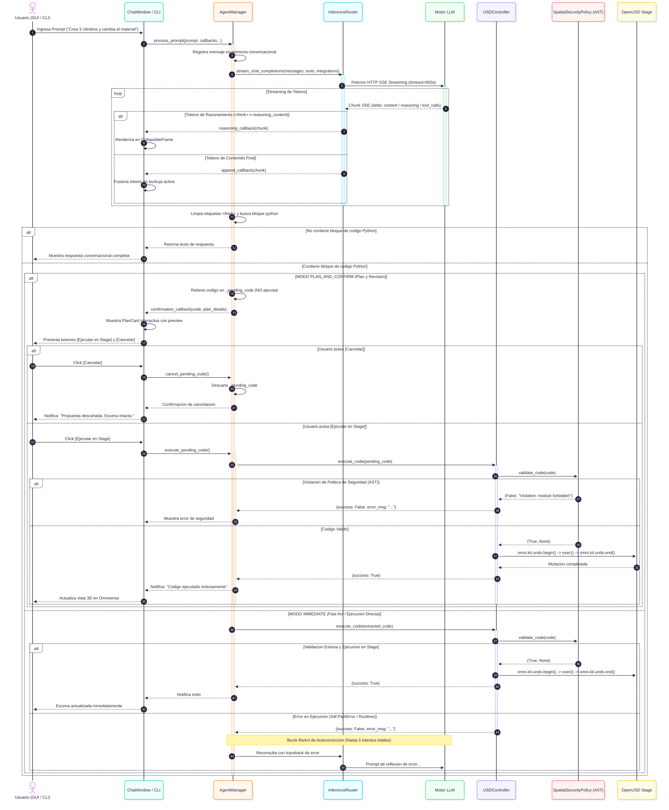
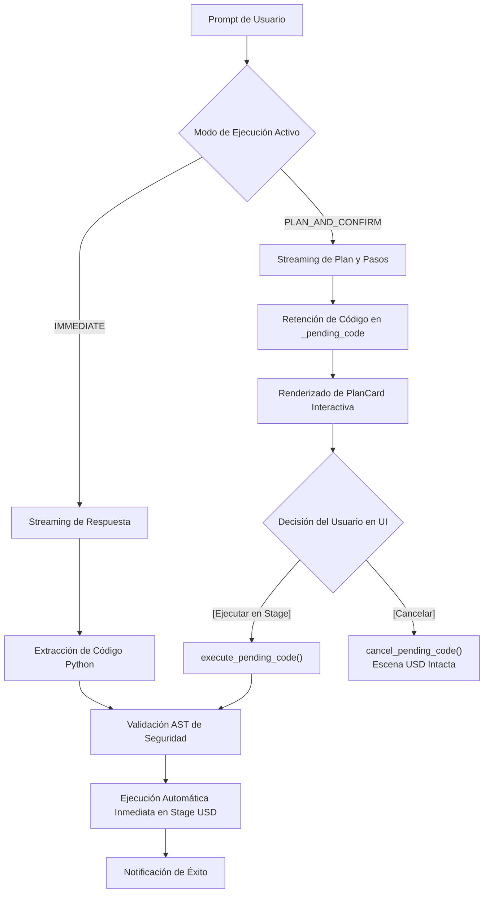

# Flujos Conversacionales, Modos de Ejecución y Recuperación ReAct

## 1. Visión General del Bucle Conversacional

El ciclo de interacción en **LM-Chat™** está diseñado para ser completamente asíncrono, altamente responsivo y tolerante a fallos, ya sea a través de la interfaz gráfica nativa (`omni.ui`) o desde la consola de terminal interactiva (`cli/lmchat_cli.py`).


*Figura 3: Flujo conversacional GUI/CLI y bifurcación entre modo inmediato y modo plan. [Editar archivo fuente (.drawio)](../diagrams/src/03_conversational_flow.drawio) • [Ver PNG](../diagrams/png/03_conversational_flow.png).*

---

## 2. Modos Duales de Ejecución: `IMMEDIATE` vs. `PLAN_AND_CONFIRM`

Para brindar flexibilidad tanto en creación rápida como en producción industrial sensible, el sistema introduce el selector de modos de ejecución:



### A. Modo Inmediato (`ExecutionMode.IMMEDIATE` — ⚡ Fast Act)
- **Orientación:** Prototipado rápido, bocetado interactivo de escenas y exploración creativa.
- **Comportamiento:** En cuanto el modelo finaliza la generación del bloque de código ` ```python ... ``` `, el código se valida mediante `SpatialSecurityPolicy` y se ejecuta inmediatamente en el Stage.
- **System Prompt:** Instruye al modelo a emitir el código Python directamente dentro de etiquetas ` ```python ` acompañado de una breve explicación.

### B. Modo Plan y Confirmación (`ExecutionMode.PLAN_AND_CONFIRM` — 📝 Plan First)
- **Orientación:** Escenarios complejos de producción, gemelos digitales y trabajo colaborativo estilo Jules / Gemini CLI.
- **Comportamiento:** El modelo enumera primero los pasos lógicos del plan y expone el código. `AgentManager` retiene el código en la variable interna `_pending_code` sin tocar la escena 3D.
- **Componente Visual `PlanCard`:** La interfaz gráfica renderiza una tarjeta estructurada con:
  - Título y descripción resumida del plan.
  - Bloque colapsable de código propuesto.
  - Botón verde **`[⚡ Ejecutar en Stage]`**: Invoca `execute_pending_code()` y aplica la mutación.
  - Botón gris **`[✕ Cancelar]`**: Invoca `cancel_pending_code()`, descartando la propuesta y manteniendo el escenario intacto.

---

## 3. Streaming SSE, Fusión de Burbujas y Modo Turbo


*Figura 4: Ciclo de inferencia, streaming SSE, razonamiento y herramientas MCP. [Editar archivo fuente (.drawio)](../diagrams/src/04_inference_streaming_tools.drawio) • [Ver PNG](../diagrams/png/04_inference_streaming_tools.png).*

### Fusión de Mensajes Progresivos
Durante el streaming de Server-Sent Events (SSE):
- Cada fragmento de texto emitido por el modelo llega a `AgentManager` mediante la corrutina `stream_chat_completions()`.
- En lugar de instanciar un nuevo widget visual por cada token, `ChatWindow.append_to_last_message()` localiza la burbuja del asistente activa y actualiza su contenido in-situ, manteniendo una alta tasa de fotogramas sin fugas de memoria en `omni.ui`.

### Modo Turbo (Micro-Batching)
Al activar la casilla **Modo Turbo** en la barra superior:
- El router agrupa pequeños lotes de tokens antes de despacharlos a la interfaz gráfica.
- Esto reduce la frecuencia de repintado del árbol de widgets en un 70%, permitiendo velocidades de generación superiores a 80 tokens por segundo en modelos locales sin degradar la respuesta visual de Omniverse.

---

## 4. Modelos de Razonamiento: Parseo de `<think>` y Widget Colapsable

Los modelos de pensamiento profundo (DeepSeek-R1, OpenAI o1/o3, Claude Thinking) emiten secuencias de introspección cognitiva antes de dar su respuesta definitiva.

### Separación de Flujos con `StreamingReasoningParser`
1. **Detección Dinámica de Etiquetas:** El parser analiza el flujo SSE en busca de `<think>` y `</think>`.
2. **Canalización a `CollapsibleFrame`:** Los tokens generados durante la fase de introspección se redirigen a un contenedor plegable con el distintivo *`Pensamiento del Modelo`*. Al concluir el pensamiento, el widget se contrae automáticamente para no saturar la pantalla.
3. **Aislamiento de Seguridad:** El extractor de código de `AgentManager` elimina estrictamente cualquier bloque delimitado por `<think>.*?</think>` antes de buscar bloques ejecutables:
   ```python
   cleaned_content = re.sub(r"<think>.*?</think>", "", full_content, flags=re.DOTALL)
   matches = _PYTHON_CODE_PATTERN.findall(cleaned_content)
   ```
   Esto previene de forma absoluta que scripts preliminares o descartados durante el proceso reflexivo del LLM sean ejecutados accidentalmente.

---

## 5. Pipeline de Ejecución OpenUSD y Bucle ReAct de Autocorrección


*Figura 5: Pipeline de ejecución OpenUSD, gobernanza AST y recuperación ReAct. [Editar archivo fuente (.drawio)](../diagrams/src/05_usd_execution_and_error_recovery.drawio) • [Ver PNG](../diagrams/png/05_usd_execution_and_error_recovery.png).*

### Gobernanza AST y Sandbox
Antes de ejecutar cualquier sentencia Python, `USDController.execute_code()` invoca `SpatialSecurityPolicy.validate_code()`:
- Comprueba que la longitud sea inferior a **100,000 caracteres**.
- Analiza el árbol sintáctico (AST) bloqueando módulos del sistema operativo (`subprocess`, `shutil`, `socket`).
- Bloquea bucles infinitos estáticos (`while True:` sin `break`) y limita las iteraciones en bucles `range` a un máximo de 10,000 ciclos (y creación de prims a 500).
- Rechaza cualquier intento de manipulación o eliminación de prims del sistema (`/OmniverseKit_Root`, `/Render`).

### Agrupamiento Undo y Reversibilidad Real
- `USDController` envuelve la llamada `exec()` entre `omni.kit.undo.begin()` y `omni.kit.undo.end()`.
- **Distinción Crítica de Reversibilidad:** El agrupamiento de undo crea un bloque compuesto en el historial de Omniverse Kit; sin embargo, para que cada mutación sea efectivamente reversible con `Ctrl+Z`, las operaciones internas deben utilizar `omni.kit.commands.execute()` o métodos del controlador (`transform_prim`, `bind_material`, `group_prims`). Mutaciones crudas fuera del sistema de comandos no generan deltas en la pila de deshacer.

### Bucle ReAct: 3 Intentos Totales (1 Inicial + 2 Reintentos)
Si el código falla durante su ejecución (por ejemplo, `Sdf.PathError: Cannot create prim at invalid path`):
1. **Intento 0 (Inicial):** El código falla; se captura la traza completa de error (`error_msg`).
2. **Intento 1 (Primer Reintento):** `AgentManager` inyecta en el historial conversacional un mensaje de usuario solicitando autocorrección con el traceback exacto:
   ```
   El código falló con este error: <error_msg>. Por favor, analiza el problema y devuelve el código corregido dentro de ```python y ```.
   ```
3. **Intento 2 (Segundo Reintento):** Si el modelo vuelve a fallar, se reitera el proceso.
4. **Agotamiento de Reintentos:** Si tras el 3er intento total el código sigue fallando, el bucle se detiene, `DiagnosticsEngine` genera una tarjeta estructurada de diagnóstico, y se notifica al usuario con el badge de error correspondiente.
