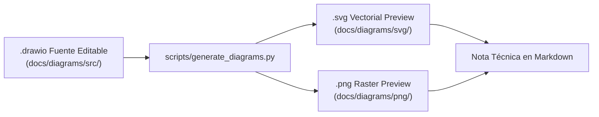

# Guía de Configuración y Navegación de la Bóveda en Obsidian

## 1. Apertura de la Bóveda en Obsidian

La carpeta `docs/` de **LM-Chat™** ha sido diseñada como una **bóveda independiente y autocontenida de Obsidian**.

### Pasos de Apertura
1. Abra la aplicación de escritorio de **Obsidian**.
2. En la pantalla de bienvenida o en el conmutador de bóvedas (ícono de bóveda en la esquina inferior izquierda), seleccione **"Open folder as vault"** (Abrir carpeta como bóveda).
3. Navegue y seleccione la ruta física:
   ```
   C:\Users\Orlando\Desktop\LM-Chat\docs
   ```
4. La bóveda cargará automáticamente la configuración predefinida en `docs/.obsidian/app.json`.
5. Abra el archivo principal [`README.md`](../README.md) para iniciar el recorrido guiado.

---

## 2. Lectura Básica sin Plugins Comunitarios Obligatorios

Conforme a las directivas de diseño del encargo, **la totalidad de la documentación es legible y navegable al 100% sin necesidad de instalar plugins comunitarios de terceros**:

- **Previsualizaciones Visuales SVG:** Todos los diagramas incluyen vistas previas vectoriales en formato `.svg` incrustadas directamente con sintaxis estándar de Markdown (``), las cuales se renderizan de forma nativa en Obsidian y en GitHub.
- **Enlaces Relativos Robustos:** Los enlaces entre notas emplean rutas relativas estándar (`../seccion/archivo.md`). Esto previene ambigüedades en Obsidian y garantiza que la navegación funcione idénticamente al explorar el repositorio en GitHub o en cualquier visor web de Markdown.
- **Estructura Frontmatter YAML:** Cada nota incorpora propiedades estandarizadas (`title`, `tipo`, `version`, `estado`, `fecha_revision`, `commit_referencia`, `aliases`, `tags`) compatibles con la vista nativa de propiedades de Obsidian.
- **Prevención de Nombres Ambiguos:** Se evitó la proliferación de archivos duplicados llamados `README.md` en subdirectorios internos; existe un único `README.md` en la raíz de `docs/` que actúa como índice maestro.

---

## 3. Visualización y Edición de Diagramas Draw.io

Cada arquitectura o flujo cuenta con su archivo fuente `.drawio` en `docs/diagrams/src/`:



### Opciones para Editar los Diagramas
1. **Opción A (Plugin de Obsidian - Opcional):**
   Si desea editar los diagramas directamente dentro de Obsidian, puede instalar el plugin comunitario *Draw.io Obsidian Integration* desde `Settings` → `Community plugins`. Al hacer doble clic en cualquier archivo `.drawio` en la barra lateral, se abrirá el editor visual integrado.
2. **Opción B (Navegador Web / diagrams.net - Sin Instalaciones):**
   - Abra [app.diagrams.net](https://app.diagrams.net/).
   - Seleccione `Open Existing Diagram` (Abrir diagrama existente).
   - Elija el archivo `.drawio` desde `C:\Users\Orlando\Desktop\LM-Chat\docs\diagrams\src\`.
   - Tras guardar sus modificaciones, ejecute `python scripts/generate_diagrams.py` para sincronizar automáticamente las imágenes SVG y PNG.

---

## 4. Navegación en Modo Grafo (Graph View)

Obsidian ofrece una visualización interactiva en grafo de todas las relaciones documentales:
1. Pulse `Ctrl + G` para abrir la **Vista de Grafo Global (Graph View)**.
2. En la sección de filtros, puede colorear los nodos por etiquetas (`tag:#arquitectura`, `tag:#auditoria`, `tag:#interfaces`, `tag:#normativa`).
3. Para explorar las conexiones de una nota específica, abra la **Vista de Grafo Local (Local Graph)** desde el menú de opciones de la nota (`...` → `Open local graph`).

---

## 5. Compatibilidad Dual con GitHub

Para asegurar que los revisores en GitHub disfruten de la misma experiencia:
- Los bloques de código utilizan resaltado de sintaxis estándar (`python`, `bash`, `json`, `mermaid`).
- Las cajas de alerta visual utilizan los contenedores nativos de GitHub Flavored Markdown:
  - `> [!NOTE]` para notas de contexto.
  - `> [!IMPORTANT]` para invariantes críticas.
  - `> [!WARNING]` para hallazgos y advertencias.
  - `> [!TIP]` para recomendaciones operativas.
