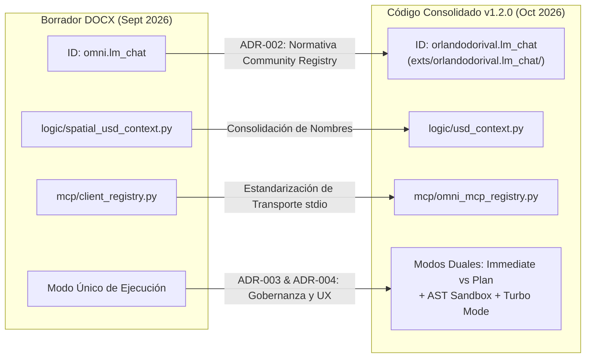

# Adaptación, Procedencia y Análisis de la Especificación Oficial (.docx)

## 1. Registro de Procedencia del Archivo Binario Original

- **Archivo Original Conservado:** `docs/LM_Chat_Product_Specification.docx`
- **Fecha de Creación Original:** Septiembre de 2026
- **Autor y Arquitecto:** Orlando Dorival
- **Entorno de Redacción:** NVIDIA Omniverse Kit SDK 105/106/107+
- **Propósito del Documento Original:** Establecer la marca comercial registrada, los pilares de la propuesta de valor y la primera matriz de transición de identificadores técnicos tras el abandono del prototipo preliminar `ia_test`.

> [!NOTE]
> **Preservación del Archivo Original:** El archivo binario `.docx` se mantiene intacto en su ruta original dentro de la carpeta `docs/`. Este documento en Markdown proporciona una incorporación estructurada de su contenido pertinente junto con un análisis crítico de las adaptaciones e inconsistencias identificadas respecto a la arquitectura finalmente consolidada en la versión `1.2.0`.

---

## 2. Contenido Incorporado de la Especificación Original

### Sección I: Identidad de Marca y Registro Técnico (Original)
- **Marca Comercial Oficial:** `LM-Chat™`
- **ID Técnico de Extensión Omniverse (Propuesta Inicial):** `omni.lm_chat`
- **Clase Principal de la Extensión:** `LMChatExtension` (con alias `MyExtension` para retrocompatibilidad)
- **Módulo de Configuración Kit:** `config/extension.toml`
- **CLI Harness Oficial:** LM-Chat Enterprise CLI (`cli/lmchat_cli.py`)
- **Lema:** *La Capa de Inteligencia Espacial y Copiloto Autónomo para NVIDIA Omniverse*

### Sección II: Propuesta de Valor Central (Original)
> *LM-Chat™ es una suite de Inteligencia Artificial Espacial de grado empresarial diseñada específicamente para el ecosistema NVIDIA Omniverse. Al integrar Modelos de Lenguaje Grande (LLMs) avanzados con OpenUSD (Universal Scene Description), LM-Chat™ transforma Omniverse en un estudio interactivo de ingeniería asistido por voz y texto. Desarrolladores, ingenieros de robótica y creadores de gemelos digitales pueden generar, inspeccionar, manipular y simular escenarios 3D complejos en tiempo real utilizando lenguaje natural.*

### Sección III: Pilares Técnicos Preliminares (Original)
- **Router Multi-Proveedor de Inferencia (`logic/inference_router.py`):** Soporte nativo para LM Studio (`:1234`), Ollama (`:11434`), vLLM (`:8000`) y APIs Cloud (Google Gemini, OpenAI, Anthropic).
- **Serializador de Contexto Espacial OpenUSD (Referenciado originalmente como `logic/spatial_usd_context.py`):** Extrae la jerarquía de prims, luces, materiales y física del escenario activo para darle percepción espacial al modelo.
- **Bucle ReAct de Autorreflexión y Autocorrección (`logic/agent_manager.py`):** Captura excepciones de ejecución (`Sdf.PathError`, `Tf.DiagnosticMark`) y solicita autocorrección al modelo sin interrumpir la sesión.
- **Ejecución No Destructiva con `omni.kit.commands`:** Soporte completo para Deshacer/Rehacer nativo (`Ctrl+Z` / `Ctrl+Y`).
- **Registro MCP (Model Context Protocol) (Referenciado originalmente como `mcp/client_registry.py`):** Conexión directa mediante JSON-RPC 2.0 a fuentes externas de datos, documentos y herramientas.

### Sección IV: Ecosistema de Interfaces (Original)
- **Interfaz Gráfica Nativa (GUI `omni.ui`):** Ventana acoplable moderna con renderizado en streaming Markdown a 60 FPS asíncronos y badge dinámico de estado.
- **Interfaz de Línea de Comandos Empresarial (CLI `cli/lmchat_cli.py`):** Consola interactiva REPL con comandos slash (`/switch`, `/model`, `/url`, `/key`, `/status`, `/clear`, `/exit`) y modo headless para automatización industrial y pipelines CI/CD.

### Sección V: Matriz Histórica de Identificadores (Original)

| Componente | Identificador Propuesto en DOCX | Identificador Anterior (Prototipo) | Estado en DOCX |
| :--- | :--- | :--- | :--- |
| **Extensión Omniverse** | `omni.lm_chat` | `orlandoexplorer.ia_test` | Propuesto |
| **Clase Extensión** | `LMChatExtension` | `MyExtension` | Propuesto |
| **Consola CLI** | `cli/lmchat_cli.py` | `cli/omni_harness.py` | Propuesto |
| **Clase CLI** | `LMChatCLI` | `OmniCLI` | Propuesto |
| **Configuración** | `config/extension.toml` | `config/extension.toml` | Propuesto |

---

## 3. Análisis Crítico de Adaptaciones y Discrepancias Técnicas

Al contrastar la especificación del archivo `.docx` con el repositorio real en su versión `1.2.0`, se identificaron y resolvieron las siguientes discrepancias fundamentales:



### Discrepancia 1: El Namespace de la Extensión
- **En el DOCX:** Se propuso `omni.lm_chat`.
- **En el Código Real:** El ID oficial y obligatorio es `orlandodorival.lm_chat`. La normativa de NVIDIA Omniverse prohíbe taxativamente que desarrolladores comunitarios o corporativos independientes utilicen el prefijo reservado `omni.*` en sus extensiones. La prueba `tests/test_omniverse_extension_layout.py` valida explícitamente:
  ```python
  self.assertFalse(mod_name.startswith("omni."), "Terceros no deben usar el namespace reservado omni.*")
  ```

### Discrepancia 2: Ubicación Física del Paquete
- **En el DOCX:** Se asumía una estructura plana con `config/extension.toml` en la raíz.
- **En el Código Real:** Omniverse Kit exige que toda extensión resida en un subdirectorio con su ID completo bajo `exts/`. Por ello, la ruta canónica consolidada es `exts/orlandodorival.lm_chat/config/extension.toml`.

### Discrepancia 3: Nomenclatura de Módulos Internos
- **En el DOCX:** Se mencionaban los archivos `logic/spatial_usd_context.py` y `mcp/client_registry.py`.
- **En el Código Real:** Los módulos fueron renombrados y consolidados como:
  - `exts/orlandodorival.lm_chat/logic/usd_context.py`
  - `exts/orlandodorival.lm_chat/mcp/omni_mcp_registry.py`

### Discrepancia 4: Nuevas Capacidades No Previstas en el DOCX
La versión `1.2.0` incorpora capacidades de segundo nivel que no figuraban en la especificación inicial:
1. **Modos Duales de Ejecución:** `IMMEDIATE` y `PLAN_AND_CONFIRM` con la tarjeta interactiva `PlanCard`.
2. **Gobernanza de Seguridad AST:** `SpatialSecurityPolicy` con bloqueo de bucles infinitos y prims protegidos.
3. **Soporte de Modelos de Razonamiento:** Parseo SSE de etiquetas `<think>` y widget `CollapsibleFrame`.
4. **Gestión de VRAM en LM Studio:** Descarga de modelos GPU mediante `POST /api/v1/models/unload`.
5. **Orquestación de Clusters Multi-Nodo:** Balanceo con failover en `ClusterManager`.
