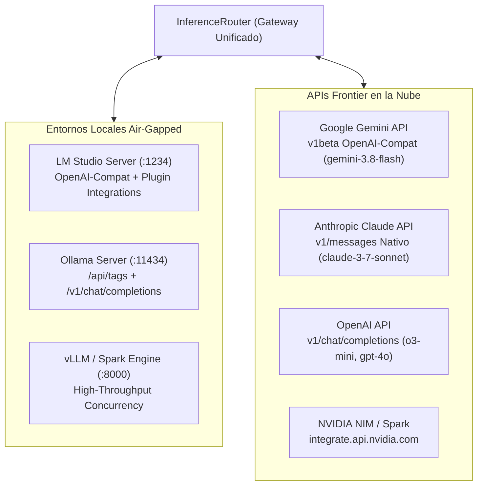

# Proveedores de Inferencia, Descubrimiento y Protocolos MCP

## 1. Catálogo Multi-Proveedor y Topología de Red

El **Router Multi-Proveedor (`logic/inference_router.py`)** unifica el acceso a una amplia gama de motores locales y servicios en la nube bajo una interfaz común asíncrona:



### Especificación de Endpoints y Puertos Predeterminados

| Proveedor | Endpoint Base por Defecto | Puerto | Formato de Payload | Autenticación |
| :--- | :--- | :---: | :--- | :--- |
| **LM Studio** | `http://localhost:1234/v1` | `1234` | OpenAI Compatible + `integrations` | Opcional (`Bearer lm-studio`) |
| **Ollama** | `http://localhost:11434/v1` | `11434` | OpenAI Compatible | Ninguna (Localhost) |
| **vLLM / Cluster** | `http://localhost:8000/v1` | `8000` | OpenAI Compatible | Opcional / Bearer Token |
| **Google Gemini** | `https://generativelanguage.googleapis.com/v1beta/openai` | `443` | OpenAI Compatible | `GEMINI_API_KEY` / `GOOGLE_API_KEY` |
| **Anthropic Claude**| `https://api.anthropic.com` | `443` | Anthropic Messages (`/v1/messages`) | `x-api-key` + `anthropic-version` |
| **OpenAI** | `https://api.openai.com/v1` | `443` | OpenAI Compatible | `OPENAI_API_KEY` (Bearer) |
| **NVIDIA NIM** | `https://integrate.api.nvidia.com/v1` | `443` | OpenAI Compatible | `NVIDIA_API_KEY` (Bearer) |

---

## 2. Descubrimiento Dinámico de Modelos (`fetch_remote_models`)

Para evitar la dependencia de catálogos estáticos desactualizados (principio de conocimiento vivo exigido por la directiva universal), el gestor de configuración implementa descubrimiento dinámico:

```python
async def fetch_remote_models(self, provider_name: str) -> List[str]:
```

1. **Protocolo OpenAI Compatible:** Consulta el endpoint estándar `GET /v1/models`. Extrae la lista de identificadores activos a partir de la clave `data[].id`.
2. **Protocolo Nativo de Ollama:** Consulta `GET /api/tags` o `GET /v1/models`, extrayendo la lista de modelos descargados localmente.
3. **Manejo de Errores y Timeouts:** Si el servidor está apagado o no responde en 5 segundos, la función retorna la lista predeterminada sin bloquear la interfaz de usuario.
4. **Refresco en la UI:** El botón de refresco junto al combo de modelos en `ChatWindow` y `SettingsWindow` dispara esta corrutina y repuebla los elementos desplegables en caliente.

---

## 3. Detección Heurística vs. Capacidades Confirmadas por el Proveedor

> [!WARNING]
> **Hallazgo de Auditoría Técnica:** En la versión actual del código base, la clasificación de capacidades de un modelo se realiza mediante **expresiones regulares heurísticas** sobre su identificador, y **no mediante un handshake dinámico de metadatos** con el backend.

### Detección Heurística Activa (`is_reasoning_model`)
En `logic/inference_router.py`:
```python
REASONING_MODEL_PATTERNS = [
    r"o1(-preview|-mini)?",
    r"o3(-mini)?",
    r"deepseek-r1",
    r"deepseek-reasoner",
    r"reasoner",
    r"qwq",
    r".*thinking.*",
    r".*-r1.*",
    r"claude-3-7",
    r"deepseek-v4",
    r"gemini-3(\.[0-9]+)?",
]
```
- Si el nombre del modelo coincide con algún patrón:
  - Se elimina el parámetro `temperature` del payload para evitar errores `400 Bad Request` en modelos de razonamiento estricto.
  - Se traduce `max_tokens` a `max_completion_tokens`.
  - Se activa el parser de etiquetas de pensamiento `StreamingReasoningParser`.

### Brecha Respecto a Capacidades Confirmadas
- **Modelos no listados en la regex:** Un modelo nuevo con soporte de razonamiento cuyo nombre no encaje en los patrones será tratado como estándar, pudiendo recibir `temperature` y fallar ante la API.
- **Capacidades de Visión:** No existe validación en tiempo de ejecución de si el modelo acepta entradas multimodales (imágenes en base64 o URLs).
- **Criterio de Cierre de Brecha:** Implementar una consulta introspectiva a la API del proveedor o permitir que el usuario sobrescriba explícitamente los flags de capacidad en `SettingsWindow`.

---

## 4. Model Context Protocol (MCP) e Integraciones de LM Studio

El soporte para herramientas externas y documentos se divide en dos mecanismos complementarios:

### A. Registro Nativo MCP (`mcp/omni_mcp_registry.py`)
- Implementa el estándar **Model Context Protocol (MCP)** mediante transporte sobre procesos secundarios (`subprocess`) comunicados por `stdin` y `stdout`.
- Utiliza tramas **JSON-RPC 2.0**:
  - `initialize`: Negociación de protocolo y capacidades.
  - `tools/list`: Descubrimiento de herramientas expuestas por el servidor.
  - `tools/call`: Ejecución de una función específica con parámetros tipados en JSON.
- Las herramientas agregadas se traducen al formato estándar de OpenAI function calling:
  ```json
  {
    "type": "function",
    "function": {
      "name": "read_cad_spec",
      "description": "Lee especificaciones mecánicas del archivo CAD",
      "parameters": { ... }
    }
  }
  ```

### B. Formato de Integraciones REST de LM Studio v1
Cuando el proveedor seleccionado es `LM Studio`, `AgentManager` detecta los servidores MCP activos y añade el bloque nativo `integrations` al payload de chat streaming:
```json
{
  "model": "google/gemma-4-e4b",
  "messages": [ ... ],
  "stream": true,
  "integrations": [
    {"type": "plugin", "id": "mcp/cad_specs"}
  ]
}
```
Esto permite que LM Studio active sus plugins internos y resuelva las llamadas a herramientas directamente en su pipeline de servidor.
