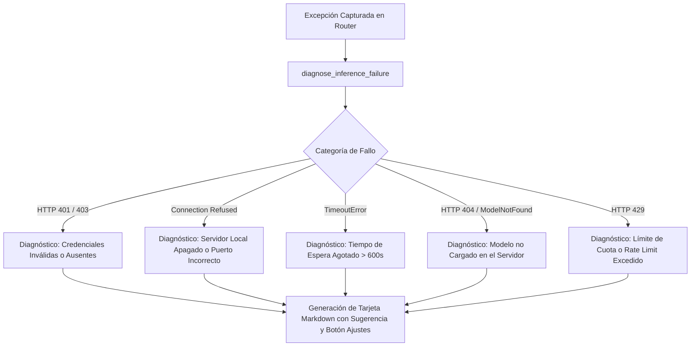

# Instalación, Operación y Diagnóstico del Sistema

## 1. Requisitos del Sistema y Entorno de Ejecución

- **Sistema Operativo:** Windows 10/11 (64 bits) o Linux Ubuntu 22.04/24.04 LTS.
- **Plataforma Host:** NVIDIA Omniverse Kit SDK 105, 106 o 107+ (incluyendo USD Composer, Isaac Sim y Omniverse Code).
- **Aceleración Gráfica:** GPU NVIDIA RTX con soporte de arquitectura Ada Lovelace, Blackwell, Ampere o Turing (mínimo 8 GB VRAM recomendados).
- **Python Runtime:** Python 3.10, 3.11, 3.12 o 3.14 (embebido en Omniverse Kit o en entorno virtual independiente para el CLI).

---

## 2. Métodos de Instalación en NVIDIA Omniverse

### Método A: Registro de Ruta Local en Extension Manager (Recomendado para Desarrollo)
1. Inicie NVIDIA Omniverse (por ejemplo, **USD Composer**).
2. Abra el menú principal: `Window` → `Extensions` (Ventana de Extensiones).
3. Haga clic en el ícono de engranaje (⚙️ **Extension Manager Settings**).
4. En la sección **Extension Search Paths**, añada la ruta absoluta donde reside la carpeta de extensiones:
   ```
   C:\Users\Orlando\Desktop\LM-Chat\exts
   ```
5. Busque en la pestaña *Community* o *Third-Party*: **"LM-Chat"** o el ID `orlandodorival.lm_chat`.
6. Active el interruptor de la extensión y habilite la opción **Autoload** si desea que inicie automáticamente con Omniverse.
7. Una nueva ventana titulada **"LM-Chat"** se acoplará en la interfaz.

### Método B: Instalación desde Archivo ZIP de Release
1. Descargue el archivo de release oficial `orlandodorival.lm_chat-1.2.0.zip` desde GitHub Releases.
2. Asegúrese de que la carpeta raíz interna del ZIP coincida exactamente con `orlandodorival.lm_chat/`.
3. Descomprima el archivo en el directorio de extensiones de usuario de Kit:
   - **Windows:** `%USERPROFILE%\AppData\Local\ov\data\Kit\<Kit_Version>\exts\`
   - **Linux:** `~/.local/share/ov/data/Kit/<Kit_Version>/exts/`
4. Reinicie Omniverse o recargue la lista de extensiones.

---

## 3. Operación de la Consola CLI (`cli/lmchat_cli.py`)

LM-Chat incluye un arnés de línea de comandos independiente diseñado para automatización industrial, pruebas de caja negra y pipelines CI/CD.

### Modo REPL Interactivo
Inicie la consola pasando el proveedor inicial deseado:
```bash
python cli/lmchat_cli.py --provider lm_studio
```

Comandos Slash disponibles en la consola interactiva:
- `/switch <provider>`: Cambia de proveedor en caliente (`lm_studio`, `ollama`, `gemini`, `claude`, `openai`).
- `/model <model_name>`: Selecciona un modelo específico para el proveedor activo.
- `/url <endpoint_url>`: Modifica la URL base del servicio de inferencia.
- `/key <api_key>`: Asigna o actualiza la clave de autenticación en memoria.
- `/status`: Despliega el diagnóstico de conexión, proveedor actual y modelo configurado.
- `/history`: Muestra el historial de las últimas interacciones.
- `/clear`: Limpia el contexto conversacional de la sesión activa.
- `/exit` o `/quit`: Finaliza la consola REPL.

### Modo Headless (Ejecución Directa por Lotes)
Ideal para integración en scripts de automatización OpenUSD y validación desatendida:
```bash
python cli/lmchat_cli.py --provider gemini --model gemini-3.8-flash --prompt "Construye una celda de manufactura con 4 cilindros y luz de domo"
```

---

## 4. Motor de Diagnósticos Inteligentes (`logic/diagnostics.py`)

Cuando una solicitud de inferencia fracasa, el sistema no expone un error técnico críptico. La función `diagnose_inference_failure()` analiza la causa raíz y genera un objeto `ErrorDiagnostic` que se renderiza como una tarjeta visual en Markdown con acciones correctivas recomendadas:



### Ejemplo de Tarjeta de Diagnóstico Renderizada en la UI

```markdown
> [!WARNING]
> ### Fallo de Conexión con LM Studio (:1234)
> **Causa Probable:** El servidor local de LM Studio no se encuentra en ejecución o el servidor de inferencia no está activo en el puerto `1234`.
> 
> **Pasos de Solución:**
> 1. Abra la aplicación de escritorio de **LM Studio**.
> 2. Vaya a la pestaña **Developer / Local Server** (<->).
> 3. Asegúrese de que el servidor esté iniciado en el puerto `1234` y con CORS habilitado.
> 4. Cargue un modelo en memoria (ej. `google/gemma-4-e4b`).
```

---

## 5. Registro Estructurado y Logging Unificado (`logic/logger.py`)

El sistema cuenta con un registrador unificado `LMStructuredLogger`:
1. **Buffer Circular en Memoria:** Mantiene en RAM las últimas 500 entradas de registro para permitir inspección instantánea desde la interfaz gráfica sin bloqueos de I/O en disco.
2. **Integración con Omniverse Carbonite (`carb.log_*`):** Despacha mensajes directamente a la consola interna de Omniverse Kit (`carb.log_info`, `carb.log_warn`, `carb.log_error`), sincronizándose con la consola nativa de Kit.
3. **Persistencia Rotativa en Disco:** Escribe en `~/.omni_lm_chat/logs/lmchat.log` con rotación automática al alcanzar 10 MB, conservando hasta 5 copias de respaldo.

---

## 6. Guía de Solución de Problemas Comunes (Troubleshooting)

| Síntoma Observado | Causa Frecuente | Solución Inmediata |
| :--- | :--- | :--- |
| **Burbuja de chat muestra "Error de Conexión: [WinError 10061]"** | LM Studio u Ollama están apagados o escuchan en otro puerto. | Verifique en `SettingsWindow` que la URL sea `http://localhost:1234/v1` (LM Studio) o `http://localhost:11434/v1` (Ollama) y pulse **Probar Conexión**. |
| **Error `400 Bad Request: 'temperature' not supported`** | Se seleccionó un modelo de razonamiento estricto (ej. o1/o3) que rechaza el parámetro de temperatura. | Asegúrese de que el nombre del modelo coincida con los patrones de razonamiento o configure `temperature: 1.0` / omisión en ajustes. |
| **El código Python generado no muta la escena 3D** | El modo de ejecución está en `PLAN_AND_CONFIRM`. | Revise el chat: aparecerá una tarjeta `PlanCard` esperando que el usuario pulse el botón verde **`[⚡ Ejecutar en Stage]`**. |
| **Aviso `PytestCacheWarning: [WinError 183]` al ejecutar pytest** | Bloqueo concurrente del directorio `.pytest_cache` por procesos huérfanos de Python en Windows. | Cierre instancias colgadas de Python con `taskkill /F /IM python.exe` o elimine la carpeta `.pytest_cache`. |
| **Falta de memoria GPU / Caída del driver RTX al cargar modelos locales** | Contención de VRAM entre el renderizado de Omniverse y el LLM. | Abra la ventana de ajustes (`Settings`) y pulse el botón **"Liberar VRAM en LM Studio"**, o descargue capas del modelo a la memoria RAM del sistema. |
