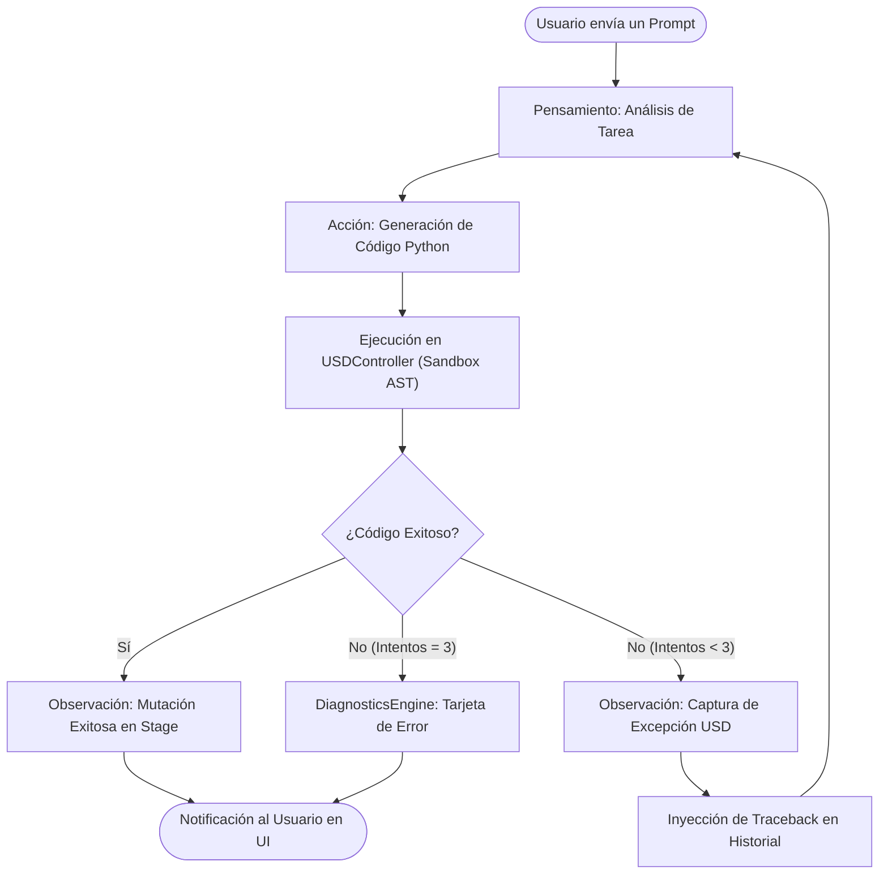

# Patrones de Diseño del Agente Cognitivo (ReAct e Inferencia)

Este documento define la arquitectura algorítmica y los mecanismos de memoria del Agente de IA Espacial en **LM-Chat™**, garantizando su capacidad de razonamiento iterativo, autorreflexión ante fallos y eficiencia de procesamiento local.

---

## 1. Patrón ReAct y Autorreflexión

El núcleo cognitivo de la IA se asienta sobre el patrón **ReAct** (Reasoning and Acting). `AgentManager` actúa como orquestador del bucle de reflexión asíncrono para ejecutar operaciones. En lugar de una generación lineal *zero-shot*, el agente opera con un ciclo reflexivo de pensamiento, acción y observación:

1. **Pensamiento (Reasoning):** El modelo analiza el requerimiento del usuario y los prims presentes en el Stage. Si es un modelo de razonamiento profundo (DeepSeek-R1, o1/o3, Claude Thinking), emite tokens de pensamiento canalizados al widget `CollapsibleFrame`.
2. **Acción (Act):** Emisión del bloque de código Python delimitado por etiquetas ` ```python y ``` `.
3. **Validación y Ejecución (Observation):** `USDController` valida el código mediante `SpatialSecurityPolicy` (AST) y lo ejecuta en el Stage dentro de un bloque `omni.kit.undo`.
4. **Reflexión ante Fallos:** Si ocurre una excepción (`Sdf.PathError`, `Tf.DiagnosticMark`), la traza se captura y se reinyecta al modelo en un prompt de autorreflexión (hasta **3 intentos totales: 1 inicial + 2 reintentos**).

### Diagrama de Flujo del Bucle ReAct



---

## 2. Optimización de la Ventana de Contexto (Context Window)

Para mantener la interoperabilidad con modelos locales y de código abierto (Llama, Qwen, DeepSeek) en GPUs de consumidor, la administración de memoria del orquestador aplica la técnica de **Compresión de Búfer Rodante (Rolling Buffer Compression)**:

- Cuando la longitud combinada del historial de conversación y los ciclos de reflexión de errores supera el límite de seguridad (por defecto 8,192 tokens o configurado en `InferenceConfig.max_tokens`), el sistema aplica compresión activa:
  - Mantiene intactas las directrices fundamentales (Prompt del Sistema y metadatos de las APIs).
  - Conserva los últimos 2 turnos conversacionales completos.
  - Sintetiza la cadena de errores pasados preservando únicamente la intención original y descartando las implementaciones erróneas ya superadas.

Esto asegura prevenir fallos de inferencia por agotamiento de memoria (OOM) en el servidor LLM local y garantiza la velocidad de generación (tokens/s) sin perder la coherencia contextual del requerimiento original.
