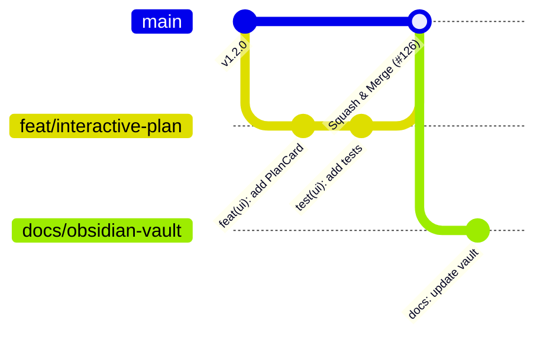

# Guía de Contribución y Flujo de Trabajo en Git

## 1. Principios de Colaboración Humano-IA

El proyecto **LM-Chat™** opera bajo el **Estatuto Universal de Colaboración (`AGENTS.md`)**, aplicable a todos los contribuyentes sin distinción: ingenieros de software, arquitectos, agentes de IA autónomos (Antigravity, Jules, Codex, Claude Code, Devin) y asistentes de IDE.

### Filosofía Central: *"Mejor que sobre a que falte"*
Priorizamos la profundidad cognitiva, el rigor en las pruebas de software y la ingeniería a prueba de fallos por encima de atajos apresurados o entregables superficiales.

---

## 2. Flujo de Ramas y Estrategia Git



1. **Protección Estricta de `main`:**
   Queda terminantemente prohibido realizar commits directos o push a la rama `main`. Todas las alteraciones deben provenir de ramas de trabajo dedicadas y canalizarse mediante Pull Requests revisados.
2. **Nomenclatura de Ramas:**
   - `feat/<nombre-de-funcionalidad>`: Para nuevas capacidades de usuario o de motor.
   - `fix/<nombre-del-fallo>`: Para corrección de errores y bugs.
   - `docs/<alcance-documental>`: Para tareas de documentación y arquitectura técnica.
   - `jules/<tarea-asignada>`: Para tareas autónomas despachadas al agente Jules.
3. **Estrategia de Integración:**
   Todo Pull Request aprobado se integra en `main` utilizando **Squash and Merge**, preservando un historial lineal, limpio y fácil de inspeccionar mediante `git bisect`.

---

## 3. Formato de Commits Convencionales (Conventional Commits)

Cada commit debe adherirse estrictamente al estándar Conventional Commits:

```text
<tipo>(<alcance>): <resumen conciso en tiempo imperativo>

[cuerpo explicativo opcional detallando motivación y consecuencias]
```

### Tipos Permitidos y su Impacto SemVer
- `feat`: Nueva funcionalidad de cara al usuario (Dispara bump **Minor**: `1.2.0` → `1.3.0`).
- `fix`: Corrección de error o anomalía (Dispara bump **Patch**: `1.2.0` → `1.2.1`).
- `docs`: Modificaciones en documentación técnica, diagramas o changelogs.
- `refactor`: Reestructuración de código sin alterar su comportamiento externo.
- `test`: Añadir o actualizar pruebas unitarias y dobles de prueba (mocks).
- `chore`: Mantenimiento de configuración, dependencias o flujos de CI/CD.
- `BREAKING CHANGE`: Cambio arquitectónico incompatible (Dispara bump **Major**: `1.2.0` → `2.0.0`).

### Verificación Local de Mensajes
```bash
uvx --from commitizen cz check --message "feat(usd): add compound undo block to USDController"
```

---

## 4. Pipeline Automatizado de Versiones y Sincronización Estricta

Para prevenir discrepancias en las versiones publicadas, el sistema impone la **sincronización multi-archivo estricta** (SemVer 2.0.0). La versión debe permanecer 100% idéntica en los 6 archivos objetivo:

1. `exts/orlandodorival.lm_chat/config/extension.toml` (`version = "X.Y.Z"`)
2. `exts/orlandodorival.lm_chat/__init__.py` (`__version__ = "X.Y.Z"`)
3. `exts/orlandodorival.lm_chat/orlandodorival/lm_chat/__init__.py` (`__version__ = "X.Y.Z"`)
4. `CITATION.cff` (`version: X.Y.Z` y `date-released: YYYY-MM-DD`)
5. `pyproject.toml` (`version = "X.Y.Z"`)
6. `docs/CHANGELOG.md` (formateado según *Keep a Changelog*)

> [!WARNING]
> Nunca modifique el número de versión manualmente en un solo archivo. Ejecute siempre el script oficial con simulación previa:
> ```bash
> python scripts/release.py [patch|minor|major] --dry-run
> ```

---

## 5. Requisitos para la Aceptación de Pull Requests

Antes de solicitar la revisión de un Pull Request:
1. **100% Pruebas Aprobadas:** La suite completa debe ejecutarse sin errores:
   ```bash
   python -m pytest tests/ -v
   ```
2. **Cumplimiento de Layout:** La prueba de estructura de extensión Kit debe pasar exitosamente:
   ```bash
   python -m pytest tests/test_omniverse_extension_layout.py -v
   ```
3. **Revisión Cruzada Multi-Agente:** Los cambios implementados por agentes de IA deben someterse a la supervisión y auditoría del supervisor (Codex/Human Architect).
