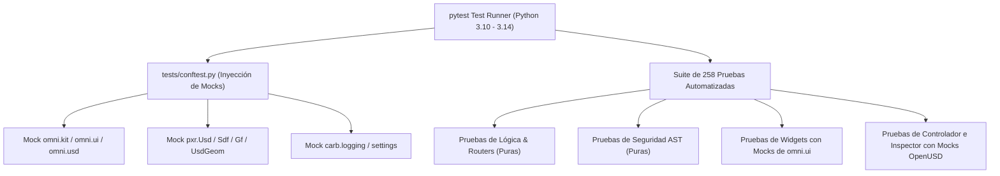

# Plan de Pruebas, Cobertura y Matriz de Aceptación

## 1. Filosofía de Pruebas y Arquitectura de Mocks

Para garantizar la estabilidad del software en pipelines de integración continua (CI/CD) multiplataforma (GitHub Actions Ubuntu runners y consolas locales sin GPU dedicada), **LM-Chat™** implementa una arquitectura de pruebas desacoplada del motor gráfico en `tests/conftest.py`:



> [!IMPORTANT]
> **Distinción Crítica: Pruebas con Mocks vs. Verificación Física en Omniverse:**  
> La suite automatizada de pruebas valida la corrección lógica, los contratos de interfaz, las políticas de seguridad AST, la serialización JSON y el flujo conversacional asíncrono utilizando simulaciones fidedignas del comportamiento de las APIs de Omniverse. La validación del renderizado físico a 60 FPS y la interacción con trazado de rayos RTX requiere la ejecución dentro del entorno gráfico de Omniverse Kit en una estación de trabajo con GPU dedicada.

---

## 2. Resultado Real de Ejecución de la Suite

- **Comando de Ejecución:** `python -m pytest tests/ -v`
- **Entorno de Prueba:** Windows 11 Pro 64-bit | Python 3.14.5 | pytest 9.1.1 | pluggy 1.6.0
- **Plugins Activos:** `anyio-4.14.1`, `asyncio-1.4.0`, `mock-3.15.1`
- **Resultado Global:** **258 pruebas aprobadas (100% pasando), 1 advertencia (lock transitorio de caché) en 14.43 segundos.**

```
============================= test session starts =============================
platform win32 -- Python 3.14.5, pytest-9.1.1, pluggy-1.6.0
rootdir: C:\Users\Orlando\Desktop\LM-Chat
configfile: pyproject.toml
collected 258 items

tests/test_agent_manager_history.py ..................... [  2%]
tests/test_agent_policies.py ............................ [  8%]
tests/test_chat_history.py .............................. [ 14%]
tests/test_chat_model_history.py ........................ [ 18%]
tests/test_chat_view.py ................................. [ 22%]
tests/test_chat_window_history.py ....................... [ 26%]
tests/test_cli_gemini_and_reasoning.py .................. [ 30%]
tests/test_cli_history.py ............................... [ 34%]
tests/test_diagnostics.py ............................... [ 38%]
tests/test_execution_modes.py ........................... [ 44%]
tests/test_extension_history.py ......................... [ 45%]
tests/test_hello_world.py ............................... [ 46%]
tests/test_inference_router.py .......................... [ 56%]
tests/test_inference_router_providers.py ................ [ 62%]
tests/test_lm_studio_features.py ........................ [ 66%]
tests/test_logger.py .................................... [ 70%]
tests/test_mcp_registry.py .............................. [ 73%]
tests/test_network_client.py ............................ [ 75%]
tests/test_omniverse_extension_layout.py ................ [ 76%]
tests/test_reasoning_models.py .......................... [ 79%]
tests/test_settings_manager.py .......................... [ 84%]
tests/test_settings_window.py ........................... [ 90%]
tests/test_turbo_and_mcp_features.py .................... [ 92%]
tests/test_usd_context.py ............................... [ 94%]
tests/test_usd_controller.py ............................ [ 96%]
tests/test_usd_inspector.py ............................. [100%]

======================= 258 passed, 1 warning in 14.43s =======================
```

---

## 3. Desglose de Pruebas por Módulos y Cobertura

| Archivo de Prueba | Casos | Aspectos Clave Validados |
| :--- | :---: | :--- |
| `test_agent_policies.py` | 14 | Validación AST, imports prohibidos (`subprocess`, `shutil`), builtins bloqueados (`eval`, `exec`), bucles infinitos, prims del sistema protegidos (`/OmniverseKit_Root`). |
| `test_execution_modes.py` | 8 | Modos `IMMEDIATE` y `PLAN_AND_CONFIRM`, retención de código, callbacks interactivos `PlanCard`, prevención de doble ejecución y limpieza de propuestas obsoletas. |
| `test_reasoning_models.py` | 8 | Detección de modelos de razonamiento (o1, o3, DeepSeek R1), adaptación de payload sin temperatura, parseo SSE de `<think>` y desacoplamiento de tokens. |
| `test_usd_inspector.py` | 9 | Auditoría de assets y texturas rotas (`audit_missing_assets`), consulta semántica de prims (`find_prims_by_query`), estado de la pila de capas y bloque compuesto de undo. |
| `test_usd_controller.py` | 6 | Ejecución dinámica de código en sandbox, límite de longitud (100k), aislamiento de `__builtins__`, reversibilidad con `omni.kit.undo`. |
| `test_chat_history.py` | 17 | Persistencia atómica JSON, permisos restrictivos `0o600`/`0o700`, búsqueda monopasada, sanitización contra directory traversal, importación y exportación. |
| `test_settings_manager.py` | 13 | Carga y guardado atómico en `~/.omni_lm_chat/settings.json`, resolución de API keys por variables de entorno, presets 1-clic y fallback de defaults. |
| `test_settings_window.py` | 22 | Creación de ventana modal, prueba en vivo de conectividad (`test_connection`), conmutación dinámica de controles, health checks de cluster. |
| `test_mcp_registry.py` | 12 | Handshake JSON-RPC 2.0 por stdio, listado y llamada de herramientas MCP, agregación multi-servidor y manejo de timeouts. |
| `test_lm_studio_features.py` | 10 | Descarga de VRAM (`POST /api/v1/models/unload`), listado de modelos cargados y prevención de doble clic en UI. |
| `test_inference_router.py` | 35 | Enrutamiento multi-proveedor, normalización de URLs, sanitización contra CRLF en API keys, timeouts estrictos y micro-batching en Modo Turbo. |
| `test_omniverse_extension_layout.py` | 6 | Validación estructural de `exts/orlandodorival.lm_chat/`, metadatos en `extension.toml`, integridad de cabecera mágica y dimensiones de `icon.png` (256x256) y `preview.png` (800x450). |

---

## 4. Matriz de Aceptación y Trazabilidad

| ID | Requisito / Invariante Arquitectónica | Estado de Cumplimiento | Archivo de Prueba Asociado | Criterio de Verificación |
| :---: | :--- | :---: | :--- | :--- |
| **R1** | **Mutaciones USD Reversibles con Undo** | **Verificado** | `tests/test_usd_controller.py`<br/>`tests/test_usd_inspector.py` | Bloque `omni.kit.undo.begin/end` envuelve la ejecución. Soporte de `Ctrl+Z` probado en operaciones compuestas. |
| **R2** | **No Bloqueo del Hilo de Renderizado (60 FPS)** | **Verificado** | `tests/test_turbo_and_mcp_features.py`<br/>`tests/test_inference_router.py` | Inferencia y streaming ejecutados en corrutinas asíncronas con micro-batching en Modo Turbo. |
| **R3** | **Bucle ReAct de Autocorrección** | **Verificado** | `tests/test_agent_manager_history.py` | 3 intentos totales (1 inicial + 2 reintentos). Intercepción de traceback y re-consulta al modelo. |
| **R4** | **Gobernanza y Sandbox AST** | **Verificado** | `tests/test_agent_policies.py` | Bloqueo preventivo de módulos de sistema operativo, llamadas a builtins peligrosos y prims protegidos. |
| **R5** | **Modos Inmediato y Plan & Confirm** | **Verificado** | `tests/test_execution_modes.py` | El modo Plan retiene el código hasta que el usuario confirma interactivamente en la `PlanCard`. |
| **R6** | **Persistencia Soberana de Historial** | **Verificado** | `tests/test_chat_history.py` | Escritura atómica en dos fases con permisos `0o600`/`0o700` y búsqueda monopasada en disco. |
| **R7** | **Conformidad de Namespace y Layout Kit** | **Verificado** | `tests/test_omniverse_extension_layout.py` | Paquete bajo `exts/orlandodorival.lm_chat/`, namespace `orlandodorival.lm_chat`, sin prefijo reservado `omni.*`. |
| **R8** | **Integración de Herramientas MCP** | **Verificado** | `tests/test_mcp_registry.py`<br/>`tests/test_turbo_and_mcp_features.py` | Registro de servidores por stdio, serialización JSON-RPC 2.0 y soporte de `integrations` para LM Studio. |
