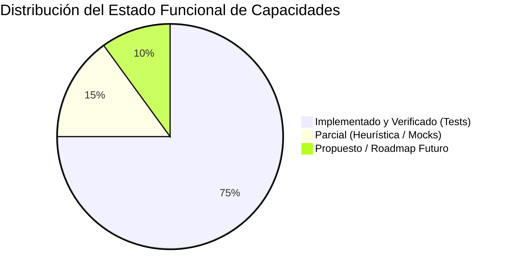

# Visión de Producto, Alcance y Estado Real de Implementación

## 1. Identidad de Marca y Misión Técnica

**LM-Chat™** es la suite de Inteligencia Artificial Espacial y copiloto autónomo desarrollada como extensión nativa para el ecosistema **NVIDIA Omniverse Kit SDK** (versiones 105, 106 y 107+), con compatibilidad verificada en entornos de autoría como USD Composer, Isaac Sim y Omniverse Code.

### Identificadores Oficiales del Sistema

| Atributo | Identificador Oficial Activo | Identificadores Históricos / Deprecados |
| :--- | :--- | :--- |
| **Marca Comercial Registrada** | **LM-Chat™** | `OmniAgent`, `ia_test` |
| **ID de Extensión Omniverse** | `orlandodorival.lm_chat` | `omni.lm_chat`, `orlandoexplorer.ia_test` |
| **Clase Principal de Extensión** | `LMChatExtension` | `MyExtension` (alias mantenido) |
| **Archivo de Configuración Kit** | `exts/orlandodorival.lm_chat/config/extension.toml` | `config/extension.toml` |
| **CLI Harness Empresarial** | `cli/lmchat_cli.py` (`LMChatCLI`) | `cli/omni_harness.py` (`OmniCLI`) |
| **Namespace Python** | `orlandodorival.lm_chat` | `omni.lm_chat` (violación de prefijo reservado) |
| **Lema Oficial** | *The Native Autonomous Spatial AI Copilot for NVIDIA Omniverse* | &mdash; |

> [!IMPORTANT]
> **Invariante de Registro Comunitario:** De conformidad con las políticas de publicación de extensiones de NVIDIA Omniverse Kit, los desarrolladores terceros **tienen estrictamente prohibido utilizar el prefijo reservado `omni.*`** en sus paquetes. El identificador oficial es `orlandodorival.lm_chat`, residiendo físicamente en `exts/orlandodorival.lm_chat/`. Cualquier referencia histórica en documentación preliminar a `omni.lm_chat` representa un borrador previo a la estandarización.

---

## 2. Propuesta de Valor Central

La interacción tradicional con escenas tridimensionales en NVIDIA Omniverse requiere un conocimiento profundo de la API en C++/Python de **OpenUSD (Universal Scene Description)**, manipulación manual de grafos de nodos, parametrización de materiales MDL y cálculo explícito de matrices de transformación geométrica.

**LM-Chat™** transforma este paradigma al tender un puente bidireccional y en tiempo real entre modelos de lenguaje de última generación (LLMs locales y en la nube) y el escenario OpenUSD activo:
1. **Percepción Espacial:** Inspecciona, serializa e inyecta la jerarquía del escenario 3D en el contexto del modelo.
2. **Generación Determinista:** Produce scripts de Python seguros que invocan comandos nativos de Omniverse.
3. **Ejecución No Destructiva:** Garantiza reversibilidad total con `Ctrl+Z` / `Ctrl+Y` mediante el Command Pattern.
4. **Resiliencia Agéntica:** Intercepta excepciones de tiempo de ejecución y ejecuta un ciclo ReAct de autorreflexión y autocorrección de hasta 3 intentos totales.
5. **Aislamiento Multi-Modalidad:** Ofrece una interfaz gráfica (`omni.ui`) de 60 FPS asíncronos y una consola de terminal REPL/Headless para automatización industrial y pipelines CI/CD.

---

## 3. Matriz de Estado: Arquitectura Implementada vs. Objetivos Futuros

Para salvaguardar la integridad de la auditoría técnica, la siguiente matriz distingue de forma explícita entre lo que **está implementado y verificado en código**, lo que cuenta con **implementación parcial** y lo que constituye **arquitectura objetivo / propuesta**:

| Capacidad / Subsistema | Estado Real | Evidencia en Repositorio | Brechas o Límites Actuales |
| :--- | :---: | :--- | :--- |
| **Router Multi-Proveedor** | `[Implementado]` | `logic/inference_router.py` `tests/test_inference_router.py` | Soporta LM Studio (:1234), Ollama (:11434), vLLM (:8000), Gemini, Claude, OpenAI. Pruebas 100% pasando. |
| **Modelos de Razonamiento (Thinking)** | `[Implementado]` | `logic/inference_router.py` `ui/chat_window.py` `tests/test_reasoning_models.py` | Detección heurística por regex (`is_reasoning_model`). Parseo de etiquetas `<think>` y campo `reasoning_content` en streaming con widget `CollapsibleFrame`. |
| **Modos Duales de Ejecución** | `[Implementado]` | `core/interfaces.py` `logic/agent_manager.py` `tests/test_execution_modes.py` | Modos `IMMEDIATE` y `PLAN_AND_CONFIRM`. Generación de tarjeta interactiva `PlanCard` con botones de ejecución y cancelación. |
| **Inspección OpenUSD (USDInspector)** | `[Implementado]` | `logic/usd_inspector.py` `tests/test_usd_inspector.py` | `audit_missing_assets`, `find_prims_by_query` y `get_layer_stack_status`. Pruebas exhaustivas con assets y capas USD reales y simuladas. |
| **Controlador USD y Sandbox AST** | `[Implementado]` | `logic/usd_controller.py` `core/policies.py` `tests/test_agent_policies.py` | `SpatialSecurityPolicy` inspecciona AST, bloquea módulos peligrosos (`subprocess`, `socket`), limita bucles e impide mutar prims protegidos. Bloque `omni.kit.undo`. |
| **Registro de Herramientas MCP** | `[Implementado]` | `mcp/omni_mcp_registry.py` `tests/test_mcp_registry.py` | Conexión con servidores MCP vía stdio (JSON-RPC 2.0). Formato de payload compatible con function calling de LLMs e `integrations` de LM Studio. |
| **Gestión de VRAM en LM Studio** | `[Implementado]` | `logic/lm_studio_vram.py` `tests/test_lm_studio_features.py` | Soporte para `POST /api/v1/models/unload` en LM Studio 0.4.x+ para liberar GPU antes de renderizar en Omniverse RTX. |
| **Clusters Multi-Nodo** | `[Implementado]` | `logic/cluster_manager.py` `tests/test_settings_window.py` | Failover y balanceo de carga (`priority`, `round_robin`, `lowest_latency`) con health checks asíncronos. |
| **Historial y Persistencia** | `[Implementado]` | `logic/chat_history.py` `tests/test_chat_history.py` | Almacenamiento local atómico en `~/.omni_lm_chat/sessions/` con permisos `0o600`/`0o700`, búsqueda monopasada, importación y exportación. |
| **Detección de Visión (Multimodal)** | `[Parcial]` | &mdash; | La detección heurística actual no incluye visión en el router ni existe captura interactiva del Viewport para inyectar imágenes base64 al LLM. |
| **Detección Dinámica de Capabilities** | `[Parcial]` | `logic/settings_manager.py` (`fetch_remote_models`) | El sistema descubre la lista de modelos vivos vía `/v1/models` o `/api/tags`, pero las capacidades (tools, reasoning) se deducen por regex y no por handshake formal de metadatos. |
| **Edición del Proyecto Completo** | `[Delimitado]` | `logic/usd_inspector.py` | La IA inspecciona y edita el *Stage USD activo y sus capas de referencia*, pero no manipula archivos de configuración `.kit`, dependencias de Python ni código fuente del proyecto. |
| **Verificación en GPU Física RTX** | `[Pendiente]` | `tests/conftest.py` (Mocks) | Las 258 pruebas pasan en entornos headless utilizando la arquitectura de mocks; la validación final del bucle de 60 FPS requiere Omniverse Kit en ejecución interactiva. |

---

## 4. Fronteras del Sistema y Límites de Alcance

Para prevenir ambigüedades operativas y falsas expectativas de integración, se establecen los siguientes límites técnicos:

### Dentro del Alcance (In Scope)
- Manipulación no destructiva de prims, geometrías, luces, cámaras, transformaciones matriciales y vinculación de materiales MDL mediante la API de comandos de Omniverse.
- Consulta, inspección semántica y auditoría de salud de escenarios OpenUSD cargados en memoria.
- Intercambio dinámico de proveedores de inferencia en tiempo de ejecución sin reiniciar la aplicación ni la extensión.
- Aislamiento estricto de la ejecución en segundo plano para salvaguardar la tasa de cuadros del motor de renderizado.
- Almacenamiento seguro, portable y auditable de sesiones de chat en formato JSON estándar.

### Fuera del Alcance (Out of Scope)
- **Modificación arbitraria del sistema de archivos del host:** El agente no tiene permitido escribir o eliminar archivos arbitrarios en el disco del usuario fuera de su directorio de datos `~/.omni_lm_chat/` o de la ruta de guardado del Stage.
- **Acceso indiscriminado a red:** El sandbox AST prohíbe el uso de librerías de sockets o clientes HTTP dentro del código Python generado por la IA.
- **Sobrescritura de extensiones nativas del motor:** Las rutas reservadas del sistema como `/OmniverseKit_Root` y `/Render` están blindadas contra mutación o eliminación.
- **Entrenamiento o ajuste fino de pesos:** LM-Chat es una capa de inferencia y orquestación agéntica; no realiza fine-tuning ni preentrenamiento de modelos en memoria.
